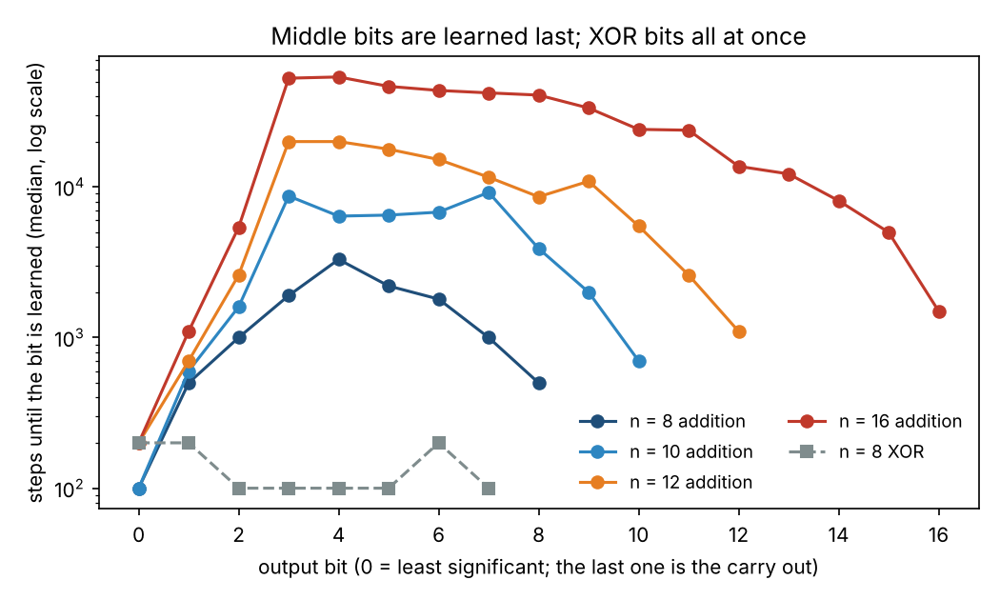
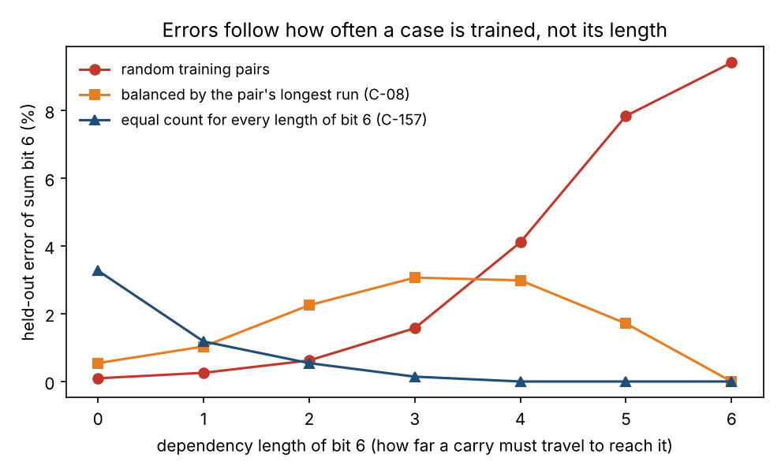
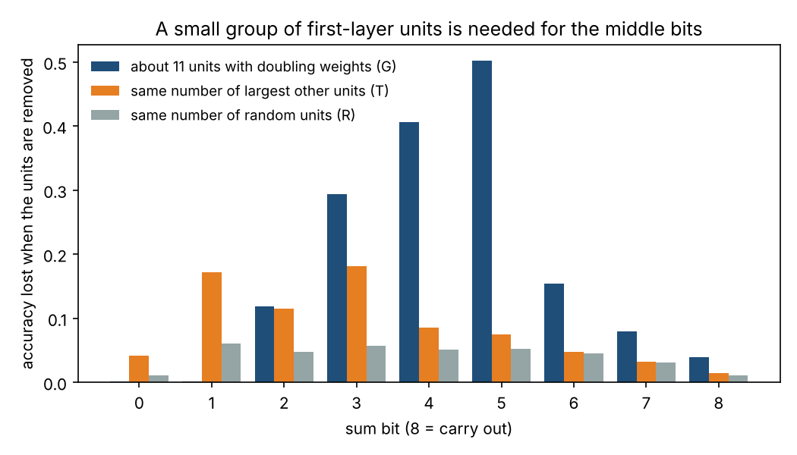
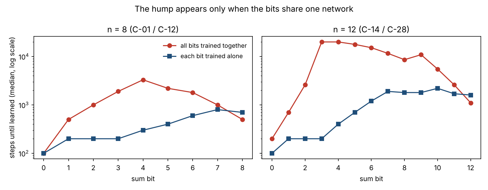
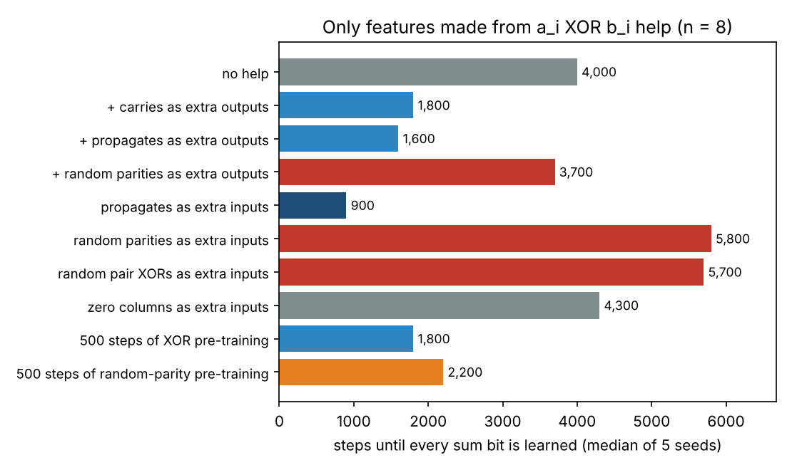
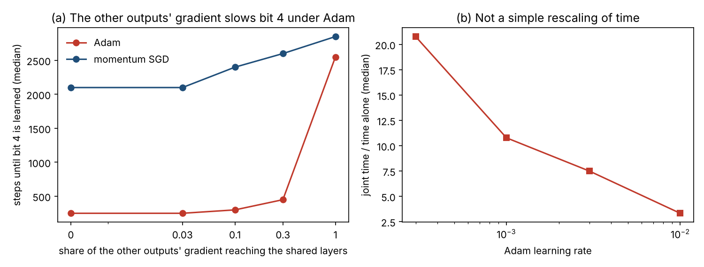
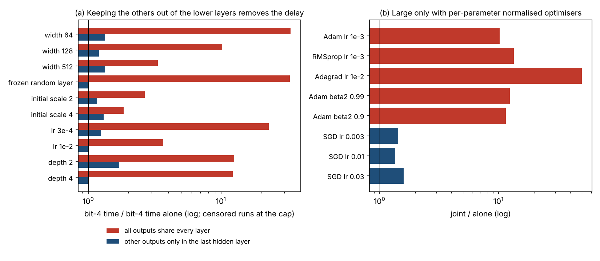
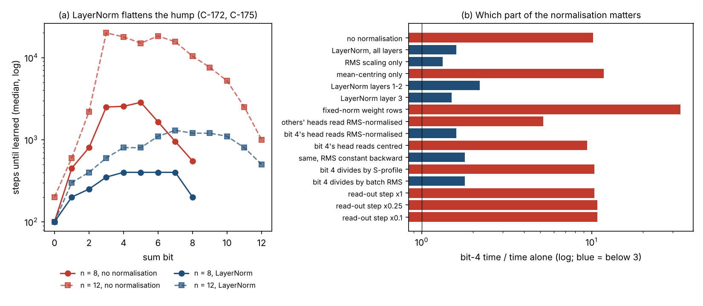
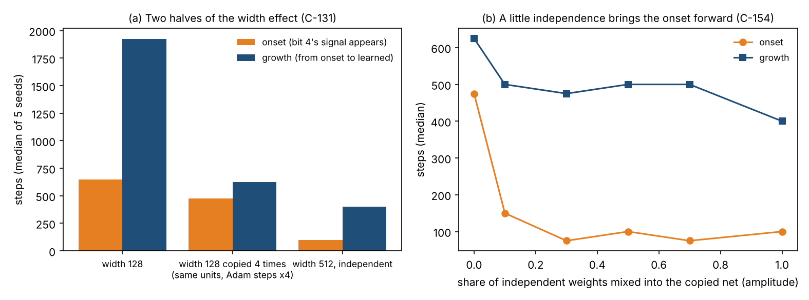
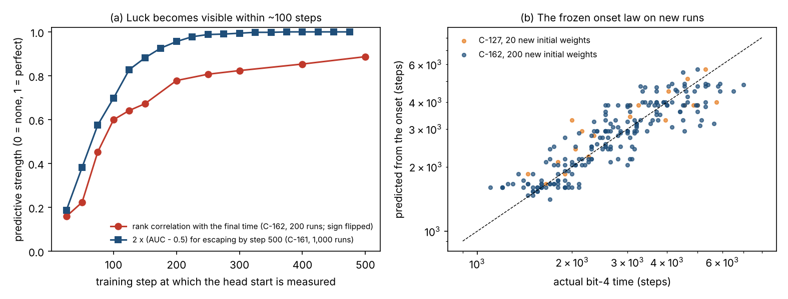

# Does a Small Network Build a Carry Chain? Binary Addition versus XOR

A study of how a small neural network learns to add two binary numbers, written up in the order the
work was done. Each part says what question we asked, where the idea came from, which files answer
it, what we found, and what it led to next.

## Summary

When a small neural network learns n-bit binary addition from answers alone, in what order does it
learn the output bits, does it build anything like a carry chain, and why? We compare it with bitwise
XOR, the same task with every carry removed. The middle sum bits are learned last: at n = 8, bit 4
takes about 3,300 training steps, while every XOR bit takes 100 to 200, and the gap grows with n.
Errors do follow the carry chain, but only because long chains are rare in the training data; at
equal training counts the long chains have no errors at all. Inside the network, about 11 first-layer
units with weights that double from bit to bit carry carry-dependent information that the output
uses, so the circuit is a mixture, not a clean ripple or lookahead adder. The slow middle bits are not
hard on their own (bit 4 alone takes 300 steps). They are slow because the fast upper bits take over
the shared hidden layers with a code of the numeric sum, and a per-parameter normalised optimiser
such as Adam turns that takeover into a 10-fold delay; with momentum SGD it costs only 1.4 times.
Keeping the other bits out of the lower layers removes all or almost all of the delay at every width,
scale, learning rate and depth we tried, and a LayerNorm in the hidden layers makes the whole adder learn about 6 to 12
times faster at n = 8 and at least 7 to 17 times faster at n = 12. Which random starting weights are lucky is decided
in the first ~100 steps and could not be read from the weights, but one early measurement predicts
the final time within about 11 percent. Everything here is measured on small networks on CPU, not proven in general.

## Contents

- [Motivation and question](#motivation-and-question)
- [1. In what order are the sum bits learned?](#1-in-what-order-are-the-sum-bits-learned) – middle bits last
- [2. Does difficulty follow the carry chain?](#2-does-difficulty-follow-the-carry-chain) – yes, but through training frequency
- [3. Is a carry represented inside the network?](#3-is-a-carry-represented-inside-the-network) – a small group of first-layer units
- [4. Is the hump a property of each bit, or of training them together?](#4-is-the-hump-a-property-of-each-bit-or-of-training-them-together) – of training them together
- [5. What speeds the adder up?](#5-what-speeds-the-adder-up) – loss weights, width, learning rate, the right features
- [6. Where the slowdown comes from: the other bits and Adam](#6-where-the-slowdown-comes-from-the-other-bits-and-adam) – their gradient, through Adam
- [7. The takeover of the shared layers](#7-the-takeover-of-the-shared-layers) – the upper bits' code of the sum
- [8. LayerNorm removes the delay](#8-layernorm-removes-the-delay) – and which part of it matters
- [9. Width, scale, learning rate, and a formula for the delay](#9-width-scale-learning-rate-and-a-formula-for-the-delay) – two halves of the width effect
- [10. Why some starting weights are lucky](#10-why-some-starting-weights-are-lucky) – a race decided in the first ~100 steps
- [11. Link to the XOR project, checks, and open questions](#11-link-to-the-xor-project-checks-and-open-questions)
- [Related work](#related-work) and [Glossary](#glossary)
- Full lab notebook: [PROGRESS.md](PROGRESS.md)

Experiment numbers match the notebook: Experiment 59 is entry C-59 in PROGRESS.md, and its files
start with `c59`. Experiments 1 to 8 and 13 were run by `adder_learn.py` to `adder_learn5.py`. A few checks
without training are named R-1, R-5, R-8, R-9 and V-1 to V-4, as in the notebook.

**Scope, up front:** everything here is small multilayer perceptrons (and one small transformer)
trained on CPU, mostly at n = 8 with 3 to 10 seeds per setting. The results are measurements of these
networks, not proofs about neural networks in general.

## Motivation and question

Our [companion project on masking](https://github.com/bank-chairat/xor-vs-add-masking) found that a
network learns one particular feature, a [parity](#parity), very late. Binary addition is a natural
next case: it differs from bitwise [XOR](#xor) only by the [carries](#carry), so comparing the two shows
what the carry costs a network. It is also a chance to compare what a trained network builds with the
circuits engineers use: the [ripple-carry adder](#ripple-carry-adder), which passes the carry from bit to
bit, and the [carry-lookahead adder](#carry-lookahead-adder), which computes carries for groups of bits
at once.

**The task.** Two n-bit numbers `a` and `b` are given as their 2n bits. The network must output the
n + 1 bits of `a + b` (the last one is the carry out). In terms of the bits:

- `p_i = a_i XOR b_i` (bit position i **propagates** a carry),
- `g_i = a_i AND b_i` (position i **generates** a carry),
- the carry into position i is `c_i`, with `c_0 = 0` and `c_(i+1) = g_i OR (p_i AND c_i)`,
- sum bit i is `s_i = p_i XOR c_i`.

So sum bit i is a parity of two things: the propagate bit of its own position and a carry that may
depend on every lower position. The **control task** is XOR: the same inputs, with outputs `p_i` only.

**Four questions.**

1. In what order does the network learn the output bits?
2. Does the difficulty of a bit follow its position, or the carry chain that reaches it in each example?
3. Is a carry represented inside the network?
4. What kind of circuit is it: a ripple chain, a lookahead, or something else?

The why behind the answer to question 1 turned out to be the largest part of the project
([Parts 4 to 10](#4-is-the-hump-a-property-of-each-bit-or-of-training-them-together)).

**Setup (used throughout unless a part says otherwise).**

- **Network:** an [MLP](#mlp) with 3 hidden layers of 128 [ReLU](#relu) units and one output per sum bit,
  trained on the sum of the bits' [binary cross-entropy](#binary-cross-entropy) losses with [Adam](#adam)
  at [learning rate](#learning-rate) 0.001 and [batch size](#batch-size) 256, on CPU.
- **Data:** at n = 8 there are 65,536 input pairs; half are used for training and half are held out.
  For n = 12 and 16 the training pairs are drawn fresh and a fixed panel of held-out pairs is never
  trained on.
- **Learning time of a bit:** the first evaluation at which its held-out accuracy is at least 0.99 and
  is still at least 0.99 at the next evaluation. A run that never gets there within its step limit is
  [censored](#censored) and counted at the limit, so those medians are lower bounds.
- **Joint and alone:** "joint" means all bits trained together in one network, as in a normal adder.
  "Alone" means one bit trained by itself (a one-output network, or from Part 6 on the same network
  with only that bit's gradient reaching the hidden layers).
- **Bit 4** of the 8-bit adder, the slowest in most runs, is used as the representative middle bit.
- **[Seeds](#seed):** 3 to 10 per setting, given in each result. Values are medians over seeds.

**Predictions first.** Before every experiment we wrote down what we expected and what would change our
mind, then scored it as held or missed. Many were missed, and this write-up says so where they were.

**Sources.** A claim goes into this write-up only if it is our own measurement or is supported by a
paper listed in [Related work](#related-work). Several experiments were suggested by notes from an
outside discussion; those are marked, and every such claim was reproduced in our own code before it was
used.

**Environment:** Python 3.13, CPU only, versions pinned in [requirements.txt](requirements.txt).
Trained weights are not in the repository; scripts that need them retrain them first.

## 1. In what order are the sum bits learned?

**Question.** Does the network learn the bits from the lowest to the highest, as a ripple adder would
compute them? And how much later than the XOR bits?

**Where the idea came from.** The masking project showed that a parity feature is learned late, and
each sum bit is a parity of `p_i` and a carry. Our prediction was that learning time would rise steadily
with bit position, because higher bits wait for longer carry chains. A historical report on tiny
networks learning 2-bit addition ([Rumelhart, Hinton & Williams 1985](https://apps.dtic.mil/sti/pdfs/ADA164453.pdf))
already reports that the overflow bit is learned first; when we made our prediction we had it only as an
unverified lead from a literature search.

**Files.**
- [adder_learn.py](experiments/adder_learn.py) – Experiments 1 and 5: n = 6 and 8, addition and XOR,
  5 seeds, held-out accuracy of every bit every 100 steps. Results in [c01/](experiments/c01).
- [adder_learn2.py](experiments/adder_learn2.py) – Experiment 6: n = 8 and 10, fresh seeds, and less
  training data. Results in [c06/](experiments/c06).
- [c14_scale.py](experiments/c14_scale.py) – Experiments 14 and 19: n = 12 and 16, Adam and momentum
  SGD, 10 seeds, strictly held-out pairs. Results in [c14/](experiments/c14), [c19/](experiments/c19).
- [summarize_part1.py](experiments/summarize_part1.py) – rebuilds Table 1, the threshold check R-2, and Figure 1.

```
cd experiments
python3 summarize_part1.py                     # seconds, from saved results
# to rerun the training (CPU):
python3 adder_learn.py c01                     # 20 training runs, slow on CPU
N=12 OPT=adam TASK=add python3 c14_scale.py c14
```

**Result 1: a hump, not a staircase (Experiments 1 and 6, 5 seeds).** The lowest bits and the top bit
are learned first and the middle bits last (Table 1, Figure 1). The XOR network learns every bit within
100 to 200 steps. Our prediction that time would rise with position was wrong for the top bits, and so
was the prediction that the top three bits would be learned after bits 0 to 2 (0 of 5 seeds).

*Table 1. Median learning time of each sum bit (steps), bit 0 first; the last bit is the carry out.*

| Task | Learning time per bit |
|---|---|
| n = 6, addition | 100, 400, 800, 1,100, 1,100, 600, 300 |
| n = 8, addition | 100, 500, 1,000, 1,900, **3,300**, 2,200, 1,800, 1,000, 500 |
| n = 8, XOR | 200, 200, 100, 100, 100, 100, 200, 100 |
| n = 10, addition | 100, 600, 1,600, 8,700, 6,400, 6,500, 6,800, 9,200, 3,900, 2,000, 700 |
| n = 12, addition (cap 20,000) | 200, 700, 2,600, 20,000, 20,000, 17,800, 15,200, 11,600, 8,600, 10,900, 5,500, 2,600, 1,100 |
| n = 16, addition (cap 60,000) | 200, 1,100, 5,400, 52,700, **53,700**, 46,500, 43,700, 42,100, 40,700, 33,400, 24,100, 23,800, 13,700, 12,200, 8,100, 5,000, 1,500 |

At n = 10, 5 of 55 bit times did not finish within 10,000 steps and are counted as 10,000; at n = 12,
12.3 percent of the cells hit the 20,000-step cap; at n = 16 with 60,000 steps, 5.9 percent did.



*Figure 1. Median learning time of each output bit, log scale. Addition (circles) peaks at the middle
bits; XOR (grey squares) learns every bit almost at once.*

**Result 2: not an artefact of the 0.99 threshold (check R-2).** With thresholds 0.90, 0.95, 0.99 and
0.999, the slowest bit at n = 8 is bit 4 every time, and the top bit takes at most about a third of
the slowest bit's time.

**Result 3: the same at larger n and with another optimiser (Experiments 14 and 19, 10 seeds).** At
n = 12 and 16, with Adam and with [momentum SGD](#momentum-sgd), the low bits and the top bit are fast and
the middle bits slow. At n = 16 the slowest bit is bit 4 at about 54,000 steps, 16 times the n = 8 value,
and the peak stays at bits 3 to 4 from n = 8 to 16. XOR stays fast (median times of 200 to 700 steps for every bit).

**What it answered.** Question 1: the middle bits are learned last, in a hump over bit position, and the
delay grows quickly with n. XOR, which has no carries, has no delay.

**What it raised.** Is a middle bit slow because carries reach it from far away (Part 2)? Does the
network compute a carry at all (Part 3)? And why would the top bit, which depends on every carry, be fast?

## 2. Does difficulty follow the carry chain?

**Question.** Within one bit, are the examples it gets wrong the ones where a carry has to travel far?
And if so, is a long carry chain hard in itself, or just rare?

**Where the idea came from.** Our own prediction, and a [Neural GPU](#neural-gpu) study that reported failures
on cases "that involve carrying a digit for many steps" ([Price, Zaremba & Sutskever 2016](https://arxiv.org/abs/1611.00736)).
An important distinction came from a literature report from an outside discussion: the number of
carries, the length of a run of carries, and the **dependency length** of a bit are different
quantities. The dependency length `d_i` of sum bit i is the number of consecutive propagate positions
directly below it (`p_(i-1)`, `p_(i-2)`, ...), that is, how far down the inputs the carry into bit i can
depend.

**Files.**
- [adder_learn.py](experiments/adder_learn.py), [adder_learn2.py](experiments/adder_learn2.py),
  [adder_learn3.py](experiments/adder_learn3.py), [adder_learn4.py](experiments/adder_learn4.py) –
  Experiments 5 to 8: errors by carry run and dependency length, and a training set balanced by the
  longest run in each pair. Results in [c06/](experiments/c06), [c07/](experiments/c07), [c08/](experiments/c08).
- [adder_learn5.py](experiments/adder_learn5.py) – Experiment 13 (check R-5): ten networks on 5 percent
  of the pairs, held-out errors saved per example. Results in [c13a/](experiments/c13a), [c13b/](experiments/c13b).
- [part2_margin_checks.py](experiments/part2_margin_checks.py) – checks R-1, V-1, R-5, V-4, R-8 and R-9 (no training).
- [c100_strata.py](experiments/c100_strata.py) – Experiment 100: errors by active carry chain at the
  moment each bit passes 0.99; scored by [c100_score.py](experiments/c100_score.py).
- [c157_own6.py](experiments/c157_own6.py) – Experiments 157, 160 and 164: training sets with an equal
  number of pairs for every dependency length of one bit; scored by [c157_partA.py](experiments/c157_partA.py)
  and [c157_partB.py](experiments/c157_partB.py). Results in [c157/](experiments/c157), [c160/](experiments/c160), [c164/](experiments/c164).
- [summarize_part2.py](experiments/summarize_part2.py) – rebuilds the numbers below and Figure 2.

```
cd experiments
python3 summarize_part2.py          # seconds
python3 part2_margin_checks.py      # about 40 s, no training
python3 c157_partB.py               # about 2.5 minutes: slopes with bootstrap intervals
```

**Result 1: while a bit is being learned, it fails where a carry reaches it (Experiments 5 and 6).** In
2,840 cases where a bit was half learned (held-out accuracy 0.60 to 0.95), the error was higher on
examples with a carry into that bit than without one in 80.3 percent of them (we had predicted at least
70 percent). The network first gets the carry-free case right.

**Result 2: the dependency length describes the leftover errors better than the carry run (Experiment 7,
5 seeds).** With 5 percent of the pairs for training, a [logistic regression](#logistic-regression) of the
held-out errors on bits 4 to 8 improves 5 to 13 times more when the dependency length is added than when
the length of the carry run is added. Each extra step of dependency multiplies the odds of an error by
about 2 to 3.

**Result 3: most of that is rarity (Experiment 8, 5 seeds).** A dependency of length d occurs in only
about one pair in 2^(d+1), so long dependencies are rare in a random training set. With the same 3,276
training pairs, but balanced across the longest propagate run in each pair, the held-out error on
examples with dependency length 4 or more falls 3 to 30 times (from 0.025–0.094 to 0.002–0.013), with no
loss of overall accuracy. A smaller slope remained, which we first read as real difficulty.

**Result 4: error-against-length cannot separate a chain from a threshold (checks R-1, R-5, V-4, R-8, R-9).**
The carry into bit i is exactly "the low-bit sum `S_i` is at least `2^i`", a threshold on a weighted sum
of the inputs. We proved, and checked on all 65,536 pairs, that a dependency of length k forces `S_i` to
lie within `2^(i-k)` of that threshold, so error against chain length and error against distance from the
threshold are tied together. Testing them apart:
- On examples where the carry is decided at once (dependency length 0), errors are 1.8 to 37 times higher
  when `S_i` is close to the threshold (all 10 seeds), but they are small (0.2 to 2 percent), so our
  pre-registered rule called the outcome inconclusive.
- At equal distance from the threshold, long chains do **not** err more than short ones (median ratio 0.64
  over 10 seeds; we had predicted at least 2).
- Neither an ideal ripple adder that only looks 2 to 4 positions down nor a noisy threshold on the sum
  reproduces that pattern, so the chain-or-threshold question, asked this way, does not describe these
  networks well.
- The XOR networks make no errors on the same examples, so the example sets themselves are not the cause.

**Result 5: at the moment a bit is learned, its last errors sit on the longest chains (Experiment 100,
5 seeds).** When bit 4 first passes 0.99, its error is 6 to 20 percent on examples whose active carry
chain has length 4 and 0.2 to 0.6 percent where no carry reaches it (median ratio 21). The same holds for
bits 3, 5 and 6. So in ordinary training, long chains are learned last.

**Result 6: at equal exposure, long chains are not harder (Experiments 157, 160 and 164).** The slope left
in Experiment 8 came from how we balanced: by the pair's longest run, not by each bit's own dependency
length. Training with an equal number of pairs for every dependency length of bit 6 turns the slope
around: lengths 4 to 6 have **no** held-out errors and the shortest the most (Figure 2). The same
happens for bit 5, and again with twice the training data.



*Figure 2. Held-out error of sum bit 6 by its dependency length, pooled over 5 seeds, for three training
sets of the same size. In every case the error follows how many training pairs a length gets, not the
length itself.*

We predicted the opposite (that the slope would survive), and were wrong. One caution: in this problem a
longer chain is also a smaller region of input space (a fraction `2^-(d+1)` of all pairs), so "harder per
example" and "harder per region" cannot be separated, and we found no clean test of "one more step of
dependency" (a contrast we first used for that, in Experiments 160 and 163, was withdrawn in Experiment 164
because both sides depend on the same positions).

**What it answered.** Question 2: the errors do follow the carry chain, first its presence and then its
length, but what makes a long chain hard for these networks is how rarely the training data cover it,
not its length.

**What it raised.** Does the network compute a carry inside it at all, and with what kind of circuit?

## 3. Is a carry represented inside the network?

**Question.** Can we find a carry inside the trained network, show that the network uses it, and say
whether the circuit looks like a ripple adder, a lookahead adder, or something else?

**Where the idea came from.** Two papers we read found carries inside other architectures: [linear
probes](#linear-probe) and ablations in transformers ([Naidu et al. 2025](https://arxiv.org/abs/2505.03997)),
and a ripple-carry program extracted from a recurrent network ([Michaud et al. 2024](https://arxiv.org/abs/2402.05110)).
A third reports that small transformers on binary addition compute with numerical values rather than a
ripple circuit ([Maltoni & Ferrara 2024](https://arxiv.org/abs/2308.01154)). The weight-profile test
(Experiment 89) was our own idea, to answer the original question about real adder circuits; the
exact 3n − 1-unit construction (check V-1) came from notes of an outside discussion and was verified here.

**Files.**
- [c02_probe.py](experiments/c02_probe.py), [c09_probe.py](experiments/c09_probe.py),
  [c10_probe.py](experiments/c10_probe.py), [c11_ablate.py](experiments/c11_ablate.py) – Experiments 2, 9,
  10, 11: linear probes and single-direction ablation. Results in [c02/](experiments/c02), [c09/](experiments/c09),
  [c10/](experiments/c10), [c11/](experiments/c11).
- [c04_width.py](experiments/c04_width.py) – Experiment 4: smallest width that fits every pair exactly.
  Results in [c04a/](experiments/c04a), [c04b/](experiments/c04b).
- [c81_walsh.py](experiments/c81_walsh.py) – Experiment 81: exact [Walsh-Fourier spectrum](#walsh-fourier-spectrum)
  of every sum bit. Output in [c81_walsh.txt](experiments/c81_walsh.txt).
- [c89_weight_structure.py](experiments/c89_weight_structure.py), [c90_ablate_geometric.py](experiments/c90_ablate_geometric.py),
  [c91_patch.py](experiments/c91_patch.py), [c92_weighted_sum.py](experiments/c92_weighted_sum.py),
  [c93_antisym.py](experiments/c93_antisym.py), [c94_layers.py](experiments/c94_layers.py),
  [c95_n12.py](experiments/c95_n12.py) – Experiments 89 to 95: weight profiles, [ablation](#ablation),
  [activation patching](#activation-patching), fresh-network replication, deeper layers, and n = 12.
  `c91_patch.py` trains and saves the ten networks the others use.
- [c151_layers23.py](experiments/c151_layers23.py) – Experiment 151: what layers 2 and 3 hold.
- [summarize_part3.py](experiments/summarize_part3.py) – rebuilds Tables 2 and 3 and Figure 3.

```
cd experiments
python3 summarize_part3.py     # seconds, from saved results
python3 c91_patch.py c91       # retrains the five networks (minutes each) and patches them
```

**Result 1: linear probes cannot answer the question (Experiments 2, 9, 10, 11).** A linear probe reads the
carry from the hidden layers perfectly, but it reads it equally well from the raw input bits, because the
carry is a threshold of a weighted sum of the inputs. This was a flaw in our design, found after the first
result. Probing for `p_(i-1) AND c_(i-1)`, which is not linear in the inputs, did not help (one seed): a network trained
on XOR, which never needs a carry, reads it just as well, and so does an untrained network. Removing the
probe's direction from layer 1 does break the middle bits, but it breaks the XOR network too. So none of
these four instruments can tell a carry from other rich features.

**Result 2: what Adam finds is much wider than needed (Experiment 4, check V-1).**

*Table 2. Smallest hidden width (on our grid) at which at least 3 of 5 seeds fit every input pair exactly.*

| Network | n = 3 | n = 4 | n = 5 | n = 6 |
|---|---|---|---|---|
| addition, 1 hidden layer | 12 | 16 | 24 | 64 |
| addition, 2 hidden layers | 6 | 12 | 16 | 24 |
| XOR, 1 hidden layer | 6 | 8 | 12 | 16 |
| XOR, 2 hidden layers | 6 | 12 | 12 | 12 |

A hand-built one-hidden-layer ReLU network with only 3n − 1 units adds exactly (checked on all pairs for
n = 3 to 10; 17 units at n = 6). So Table 2 describes what training finds, not what is necessary.

**Result 3: the targets themselves (Experiment 81, exact).** In the Walsh–Fourier view, bit 0 is a single
product of two inputs, but the middle bits have almost no weight on single inputs or pairs (0.4 percent for
bit 4) and every term of bit 4 contains `a_4 b_4`: bit 4 is literally `p_4` times a function of the lower
bits. The terms of bits 0 to 7 do not overlap at all, so any interaction between the bits during training
must come through the shared network and optimiser, not through the targets. The degree profile does not
explain the learning order (bits 4 to 7 have the same profile but different times).

**Result 4: a small group of first-layer units carries carry information that the network uses
(Experiments 89 to 93, 10 networks).** About one first-layer unit in five among the important ones has
weights that grow about 2 times per bit position, like a weighted sum of the low bits; untrained networks
have none. Removing these 10 to 14 units (out of 128) costs the middle bits far more than removing the same
number of random units or of the largest other units (Figure 3).



*Figure 3. Accuracy lost by each sum bit when a group of layer-1 units is replaced by its mean (mean over
10 networks). G: units with doubling weights; T and R: as many of the largest other units, or random units.*

To show the units carry the **carry**, we used patching: take two inputs that differ only in the lower bits,
so that the carry into bit i differs, run the network on the first, and paste in the G units' activations
from the second. If bit i then flips to the second input's answer, those units carry what decides it.

*Table 3. Patching flip rate (share of input pairs whose sum bit takes the counterfactual value).*

| Networks | Bit | G units | T units | R units |
|---|---|---|---|---|
| first 5 (Experiment 91) | 3 | 0.38 | 0.22 | 0.07 |
| | 4 | 0.48 | 0.11 | 0.08 |
| | 5 | 0.74 | 0.06 | 0.05 |
| 5 fresh networks (Experiment 93) | 3 | 0.21 | 0.24 | 0.09 |
| | 4 | 0.63 | 0.12 | 0.07 |
| | 5 | 0.58 | 0.09 | 0.08 |

The bit-4 and bit-5 results replicate on fresh networks; the bit-3 result does not.

**Result 5: what these units compute (Experiments 92 and 93).** The G units are not simply linear in the
weighted sum of the low bits (median R² 0.27, against our prediction of 0.8). Looking at their weights
showed why, and the description was then tested on the fresh networks: below some position k the weights
double per position and are equal on `a_j` and `b_j`, and at position k the weights on `a_k` and `b_k` are
large and of opposite sign. Such a unit reports the low-bit sum when `a_k = b_k` and shifts it when they
differ, which is a building block of a carry computation. 70 percent of G units fit this description, against
32 percent of random units.

**Result 6: deeper layers and larger n (Experiments 94, 95, 151).** The carry-dependent signal is most
concentrated in layer 1 and spreads out with depth: patching the top 8 units flips bit 4 in 64, 48 and 29
percent of pairs in layers 1, 2 and 3 (we had predicted the reverse). At n = 12 the G units matter just as
much (ablation drop 0.38 against 0.11 for random units; flip rate 0.53 at bit 7), but only 48 percent fit
the opposite-sign description. In trained networks, layers 2 and 3 are dominated by a code of the numeric
sum `S = a + b` (it explains 50 to 85 percent of layer 2's variance and 80 to 91 percent of layer 3's), with
no dedicated units for bit 4's two factors; bit 4 is a small component riding on that code (at most 1.8
percent of layer-3 variance).

**What it answered.** Question 3: yes, in the sense of a carry-dependent signal that the output uses, sitting
in a small group of first-layer units, though not as a single clean carry bit. Question 4: a mixture. The
units have weights over 4 or more positions (not a local ripple chain), a minority compute a weighted sum
corrected by the next position's propagate state, and the deeper layers carry a code of the numeric sum.

**What it raised.** None of this explains why the middle bits are slow. Is a middle bit simply hard?

## 4. Is the hump a property of each bit, or of training them together?

**Question.** [Part 1](#1-in-what-order-are-the-sum-bits-learned) found the middle bits slow. Is a middle
bit simply a harder function to learn, or is it slow because it shares one network with the other bits?

**Where the idea came from.** Our own question. We predicted that each bit is hard in itself (the slowest
bit trained alone would still be a middle bit), and were wrong.

**Files.**
- [c12_single.py](experiments/c12_single.py), [c28_single12.py](experiments/c28_single12.py) – Experiments
  12 and 28: one network per bit, n = 8 and 12. Results in [c12/](experiments/c12), [c28/](experiments/c28).
- [c15_subsets.py](experiments/c15_subsets.py), [c31_subsets12.py](experiments/c31_subsets12.py) –
  Experiments 15, 16, 29, 30 and 31: bit 4 trained with chosen sets of other bits. Results in
  [c15/](experiments/c15), [c16/](experiments/c16), [c29/](experiments/c29), [c30/](experiments/c30), [c31/](experiments/c31).
- [c17_grad.py](experiments/c17_grad.py) – Experiment 17: how the bits' gradients line up.
- [c18_weight.py](experiments/c18_weight.py), [c20_weight.py](experiments/c20_weight.py) – Experiments 18
  and 32: weights on the bits' losses. Results in [c18/](experiments/c18), [c32/](experiments/c32).
- [c33_trunk.py](experiments/c33_trunk.py), [c34_wide.py](experiments/c34_wide.py), [c37_loss.py](experiments/c37_loss.py) –
  Experiments 33, 34 and 37: private layers per bit, a wider shared network, and early losses.
- [summarize_part4.py](experiments/summarize_part4.py) – rebuilds Table 4 and Figure 4.

```
cd experiments
python3 summarize_part4.py       # seconds, from saved results
python3 c12_single.py c12        # 27 one-bit networks, minutes each
```

**Result 1: trained alone, a bit shows no hump (Experiments 12 and 28).** At n = 8 the time of a bit
trained alone rises gently with position, from 100 to 800 steps; bit 4 alone takes 300 steps, against
3,300 in the joint network. At n = 12, bit 4 alone takes 400 steps, against more than 20,000 jointly
(Figure 4). The rank correlation between the alone and joint profiles is 0.23 at n = 8 and 0.15 at n = 12.



*Figure 4. Median learning time of each sum bit when all bits share one network (red) and when each bit
has its own network (blue), at n = 8 and n = 12. Log scale.*

**Result 2: the upper bits are what slow bit 4 (Experiments 15, 16, 29, 30, 31).** Training bit 4 with
different sets of other bits:

*Table 4. Steps for bit 4 to reach 0.99 with different co-trained bits (median of 5 seeds).*

| Bits trained together | n = 8 | | Bits trained together | n = 12 |
|---|---|---|---|---|
| {4} alone | 300 | | {4} alone | 400 |
| {2, 3, 4, 5, 6} (neighbours) | 400 | | {0 to 4} (lower bits) | 700 |
| {0 to 4} or {0 to 6} (lower bits) | 700 | | {4, 9, 10, 11, 12} (top bits) | 4,600 |
| {4, 8} | 700 | | {4 to 12} | 9,300 |
| {4, 5, 6} | 500 | | all 13 bits | 17,900 |
| {4, 6, 7, 8} | 1,800 | | | |
| {4 to 8} (upper bits) | 2,000 | | | |
| all 9 bits | 2,600 | | | |

The neighbouring bits cost almost nothing; the lower bits cost a little; the upper bits, and especially
the carry out together with bits 6 and 7, cost almost the whole delay. It grows with the number of upper
bits added rather than coming from one of them. Several of our predictions about which sets would matter
were missed; the table is the result.

**Result 3: the gradients do not fight (Experiment 17).** In the shared layers the [gradient](#gradient) of
bit 4 is nearly at right angles to the others' (cosines between −0.05 and +0.13 during the first 1,000
steps), not opposed to them. So this is not a simple tug of war.

**Result 4: the loss weights decide who goes first (Experiments 18 and 32).** Weighting bit 4's loss 3
times takes it from 2,600 to 500 steps (and 10 times to 300, its alone time), while some other bits get
slower. Weighting the upper bits 5 to 8 down to 0.1 also frees bit 4 (600 steps), and bit 5 then never
finishes within 10,000 steps. So the hump is a matter of priority among bits that share the network.

**Result 5: sharing or size? (Experiments 33, 34, 37).** Giving each bit its own layers after one shared
layer almost removes the delay (bit 4: 400 against 3,700 with three shared layers). We read this as
interference from sharing, but a fully shared network as wide as those private layers (384 units) is just
as fast (bit 4: 900; slowest bit 900), so the gain came from the extra size, not from un-sharing; we
corrected our reading. Early held-out losses (Experiment 37) show that bits 0 and 8 are the easiest bits
even when trained alone, and that in the joint network bits 3 and 4 stall while the others fall.

**What it answered.** The hump is not a property of each bit's function. It appears when the bits are
trained together, it comes mostly from the upper bits, and loss weights can move it from bit to bit.

**What it raised.** If the middle bits are held back rather than hard, what speeds them up (Part 5), and
by what route do the upper bits hold them back (Part 6)?

## 5. What speeds the adder up?

**Question.** Which changes shorten the slow middle-bit phase, and what do the ones that work have in common?

**Where the ideas came from.** Loss weights followed from [Part 4](#4-is-the-hump-a-property-of-each-bit-or-of-training-them-together).
Width and learning rate followed from the wide-network result there. Extra outputs for intermediate
quantities (carries or propagates) are a standard curriculum idea that also appeared in notes from an
outside discussion. Giving the propagate bits as inputs came from our masking project, where a parity
input removed most of XOR's delay. The degree-2 control (Experiment 99) reproduces a control suggested in
those outside notes. The transformer and pre-training tests were our own generality checks, and so was
the "weak correlation" explanation we tested and then withdrew.

**Files.**
- [c20_weight.py](experiments/c20_weight.py), [c21_scale.py](experiments/c21_scale.py), [c22_adapt.py](experiments/c22_adapt.py),
  [c23_scale.py](experiments/c23_scale.py), [c24_ctrl.py](experiments/c24_ctrl.py), [c26_sharp.py](experiments/c26_sharp.py),
  [c38_lr.py](experiments/c38_lr.py), [c42_scale.py](experiments/c42_scale.py) – Experiments 20 to 27, 38 and 42: fixed and
  adaptive loss weights.
- [c34_wide.py](experiments/c34_wide.py), [c40_scale.py](experiments/c40_scale.py) – Experiments 35, 36, 39 to 41: width
  and learning rate.
- [c43_aux.py](experiments/c43_aux.py), [c44_aux4.py](experiments/c44_aux4.py), [c45_pi.py](experiments/c45_pi.py),
  [c47_aux67.py](experiments/c47_aux67.py), [c48_aux12.py](experiments/c48_aux12.py) – Experiments 43 to 48: extra outputs.
- [c49_inputs.py](experiments/c49_inputs.py), [c50_pin.py](experiments/c50_pin.py), [c52_lookahead.py](experiments/c52_lookahead.py),
  [c99_deg2.py](experiments/c99_deg2.py) – Experiments 49, 50, 52 and 99: extra inputs.
- [c55_pretrain.py](experiments/c55_pretrain.py) – Experiments 55 and 56: pre-training the hidden layers.
- [c54_transformer.py](experiments/c54_transformer.py), [c57_transformer_p.py](experiments/c57_transformer_p.py) – Experiments 54
  and 57: a small transformer.
- [c46_bias.py](experiments/c46_bias.py), [c51_parity.py](experiments/c51_parity.py), [c53_latent.py](experiments/c53_latent.py) –
  Experiments 46, 51 and 53: tests of the weak-correlation idea.
- [summarize_part5.py](experiments/summarize_part5.py) – rebuilds Tables 5 to 7 and Figure 5.

```
cd experiments
python3 summarize_part5.py       # seconds, from saved results
python3 c49_inputs.py c49        # propagate inputs and the random-parity control, 10 runs
```

**Result 1: loss weights help while the run is long (Experiments 20 to 27, 38, 42).** A hand-made profile
that weights the middle bits more halves the time for the whole adder at n = 8 (4,000 to 2,100 steps), but
slows bits 0 and 1 three to four times. A rule that weights each bit by its current loss needs no hand
tuning and slows no bit noticeably: about 25 percent faster at n = 8 (in 5 of 5 seeds, and again on 5 new
seeds). Giving the same weights to the wrong bits (shuffled each update) is slower than no weighting, so
the assignment matters. At n = 12 it cuts the share of bit times that never finish from 21.5 to 6.2
percent, and at n = 16 with 60,000 steps it brings the slowest bit from 53,700 to 38,100 steps. At three
times the learning rate it gives nothing at n = 8 (1,550 against 1,500) but still 32 percent at n = 16
(15,300 to 10,400), so it helps when the slow phase is long.

**Result 2: width and learning rate both shorten it (Experiments 35, 36, 39 to 41).**

*Table 5. Steps until every bit is learned, n = 8 (median of 5 seeds).*

| Width | lr 0.001 | lr 0.003 | lr 0.01 |
|---|---|---|---|
| 128 | 4,000 | 1,600 | 600 |
| 256 | 1,500 | 700 | 400 |
| 512 | 700 | 400 | 300 |

Width 64 does not finish within 10,000 steps and width 1,024 takes 500. A single power law does not fit the
grid: the effects of width (about `W^-0.9`) and learning rate (about `lr^-0.6`) weaken as the other grows,
and the fastest cells approach a floor of a few hundred steps. At n = 12, learning rates 0.003 and 0.01
bring the slowest bit from more than 20,000 to 6,900 and 3,200 steps; at n = 16, 0.003 removes all
censoring (slowest bit 15,300).

**Result 3: only the right features help (Experiments 43 to 50, 52, 99).**

*Table 6. Steps until every sum bit is learned, and steps for bit 4, n = 8 (median of 5 seeds).*

| Change | All bits | Bit 4 |
|---|---|---|
| none | 4,000 | 2,600 |
| carries `c_i` as extra outputs | 1,800 | 1,400 |
| propagates `p_i` as extra outputs | 1,600 | 1,300 |
| 8 random parities as extra outputs | 3,700 | 1,900 |
| propagates `p_i` as extra **inputs** | **900** | **600** |
| 8 random parities as extra inputs | 5,800 | 4,200 |
| 8 random pair XORs (never `a_i, b_i`) as extra inputs | 5,700 | 5,500 |
| 8 zero columns as extra inputs | 4,300 | 4,300 |
| 500 steps of pre-training on XOR | 1,800 | 900 |
| 500 steps of pre-training on random parities | 2,200 | 2,000 |



*Figure 5. Steps until every sum bit is learned at n = 8 under the changes of Table 6. Grey: no or neutral
change; blue: changes built from `a_i XOR b_i` or carries; red: random parity features; orange: random
pre-training.*

- **Bit by bit.** Supervising bit 4's own propagate `p_4` alone takes bit 4 from 2,600 to 700 steps; its
  own carry `c_4` alone does nothing (2,500); both together give 300, its alone time. Other positions'
  propagates do not help bit 4. The own propagate helps bits 3 to 5 most (3 to 5 times); bit 6 needs both
  its propagate and its carry (600 steps).
- **At n = 12** the own propagate takes bit 4 from 17,900 (two seeds never finishing) to 1,000 steps, and
  with its carry to 400, the alone time.
- **At n = 12 and 16 with propagate inputs** no bit is censored any more (slowest 3,300 and 8,400 steps),
  but a smaller hump remains in the middle of the word (bit 7 of 12, bit 8 of 16). Adding two-bit
  lookahead features (`g_i`, and generate and propagate over pairs of positions) at n = 12 brings the
  slowest bit to 1,000 steps. So once `a_i XOR b_i` is given, what is left is combining carries over
  several positions.
- **Not just lower degree.** Random XORs of two input bits help nothing; the feature must be `a_i XOR b_i`
  of the same position, a factor of the sum bit itself.

**Result 4: pre-training (Experiments 55 and 56).** 500 steps of pre-training the hidden layers on XOR
make the adder 2.2 times faster (bit 4: 900), and 100 steps already give the whole benefit. Pre-training on
random parities also helps (1.8 times), so part of the gain is generic; XOR is better at every length
tried, and given inputs (900) are better than pre-trained features (1,800).

**Result 5: a small transformer shows top bits first too, but a different shape (Experiments 54 and 57).**

*Table 7. Median learning time per bit of a 2-layer transformer, n = 8 (5 seeds, cap 20,000).*

| Inputs | Bits 0 to 8 |
|---|---|
| plain bit tokens | 1,900, 5,700, 7,800, 7,200, 7,700, 6,500, 5,300, 1,200, 700 |
| plus propagate tokens | 200, 900, 2,700, 3,900, 4,100, 3,200, 2,400, 1,400, 900 |

The [transformer](#transformer) learns the top two bits first and the middle last, but the low bits are slow too (a wide plateau
over bits 1 to 6 rather than a peak). Propagate tokens speed bits 0 to 6 by 2 to 8 times but leave a hump
(bit 4: 4,100). So in the transformer the XOR features are part of the delay, not all of it.

**Result 6: an explanation we tested and withdrew (Experiments 46, 51, 53).** We had suggested that `s_i =
p_i XOR c_i` is hard because each part is only weakly correlated with `s_i`. Two synthetic tests went the
other way: a two-bit parity is learned fastest when it is perfectly balanced (50 steps against 150), also
when one part is a hidden threshold of eight inputs. We withdrew the explanation. (Biasing the input bits
does flatten the alone profile, from a ratio of 8 between bits 7 and 2 down to 1; that observation stays
unexplained.)

**What it answered.** The middle-bit delay is largely the time to build features from `a_i XOR b_i` (and,
for the higher bits, the carries), and it shrinks with anything that makes training faster: width,
learning rate, loss weight, or giving the features directly.

**What it raised.** Why do those features form so slowly when all bits train together, if a bit alone
builds them in a few hundred steps?

## 6. Where the slowdown comes from: the other bits and Adam

**Question.** By what route do the other bits slow bit 4 down: through their gradient into the shared
layers, through the optimiser, or through something else?

**Where the ideas came from.** Measuring when `a_4 XOR b_4` becomes readable (Experiment 58), scaling only
the gradient the other bits send into the shared layers (59), trying plain momentum SGD (60), and the
"dilution" model of Adam (61) were our own steps from Parts 4 and 5. Batch size (65) came from the masking
project, where label noise set the delay. Giving each output its own Adam moments (73) was our direct test
of the dilution model; outside notes suggested the same test, and it turned out to be a published idea for
multi-task learning ([Yang et al. 2023](https://arxiv.org/abs/2211.15055)). The learning-rate ratio (97),
the curvature claim (101) and the continuation experiment (104) reproduce claims from outside notes in our
own code.

**Files.**
- [c58_probe_time.py](experiments/c58_probe_time.py) – Experiment 58: when `a_4 XOR b_4` becomes linearly readable.
- [c59_gradshare.py](experiments/c59_gradshare.py), [c60_gradshare_opt.py](experiments/c60_gradshare_opt.py),
  [c61_dilution.py](experiments/c61_dilution.py), [c62_variance.py](experiments/c62_variance.py),
  [c64_dilution_subset.py](experiments/c64_dilution_subset.py), [c65_batch.py](experiments/c65_batch.py) –
  Experiments 59 to 62, 64 and 65.
- [c73_sepmoments.py](experiments/c73_sepmoments.py), [c97_lr_ratio.py](experiments/c97_lr_ratio.py) –
  Experiments 73 and 97; [c97_score.py](experiments/c97_score.py) scores 97.
- [c101_train_ckpt.py](experiments/c101_train_ckpt.py), [c101_hessian.py](experiments/c101_hessian.py),
  [c102_ratio.py](experiments/c102_ratio.py), [c96_frozen_resid.py](experiments/c96_frozen_resid.py) –
  Experiments 96, 101 and 102: curvature.
- [c104_history.py](experiments/c104_history.py), [c106_layerswap.py](experiments/c106_layerswap.py),
  [c107_adamparts.py](experiments/c107_adamparts.py), [c108_adamlayers.py](experiments/c108_adamlayers.py),
  [c109_history_length.py](experiments/c109_history_length.py), [c110_pretrain_kinds.py](experiments/c110_pretrain_kinds.py) –
  Experiments 104 and 106 to 110: what joint training leaves behind.
- [summarize_part6.py](experiments/summarize_part6.py) – rebuilds the numbers below and Figure 6.

```
cd experiments
python3 summarize_part6.py            # seconds, from saved results
python3 c59_gradshare.py c59          # 25 runs, about a minute each
```

**Result 1: the feature forms just before the bit is learned (Experiment 58, 5 seeds).** A linear probe
reads `a_4 XOR b_4` at 95 percent accuracy after 50 steps when bit 4 is trained alone, after 500 to 600
steps with four other bits, and after 2,400 steps with all nine, just before bit 4 itself is learned
(2,600). In 4 of 5 joint runs this readability first **drops** during the first 300 to 500 steps. One
caveat: with only the upper bits, the feature is readable early but bit 4 is still slow, so forming the
feature is not the whole story.

**Result 2: it is the other bits' gradient into the shared layers (Experiment 59, 5 seeds).** We kept every
output head training normally and scaled only the gradient that the other eight outputs send back into the
hidden layers by a factor λ. Bit 4 takes 250, 250, 300, 450 and 2,550 steps for λ = 0, 0.03, 0.1, 0.3 and
1 (Figure 6a). Their heads do not matter; their gradient into the shared layers does.

**Result 3: under momentum SGD the same gradient costs little (Experiment 60, 5 seeds).** With momentum SGD,
the same change from λ = 0 to 1 takes bit 4 from 2,100 to 2,850 steps, 1.36 times, against 10.2 times with
Adam (SGD alone is 8 times slower than Adam alone, so the two are at different speeds).

**Result 4: part of it is Adam's shared step size (Experiments 61, 64, 73).** Adam divides each parameter's
step by a running average of its squared gradient (its [second moment](#second-moment)). In the shared
layers that average is dominated by the other eight outputs, so bit 4's contribution to each step is about
4 times smaller than when it trains alone (the factor is 0.24 on average over the first 500 steps). More
co-trained bits make it smaller (0.7 with one, 0.24 with eight). Giving each output its own Adam moments in
the shared layers takes bit 4 from 2,550 to 900 steps; scaling those separate steps down by 3 brings it
back to about the ordinary time (2,900). So the shared second moment costs about a factor of 3, and about
3.6 times the alone time was left over (explained in [Part 7](#7-the-takeover-of-the-shared-layers)).

**Result 5: not gradient noise, and set by the starting weights (Experiments 62 and 65).** With the data
split fixed, 73 percent of the variance of the (log) bit-4 time is between initial weights and 1 percent
between batch orders. Raising the batch from 256 to 4,096 barely changes the joint time (2,550 to 2,250)
while bit 4 alone gets 2.5 times faster (250 to 100), and the order of the seeds stays the same. Unlike the
masking project, this delay is not mainly sampling noise.

**Result 6: not a simple rescaling of time (Experiment 97, 5 seeds).** The joint-over-alone ratio falls
from 20.8 at learning rate 0.0003 to 10.8, 7.5 and 3.3 at 0.001, 0.003 and 0.01 (Figure 6b). If the delay
were the same dynamics run more slowly, the ratio would not depend on the learning rate.



*Figure 6. (a) Steps for bit 4 when the other outputs' gradient into the shared layers is scaled by a
factor (x axis), under Adam and momentum SGD. (b) Joint time divided by alone time for bit 4 at four Adam
learning rates.*

**Result 7: curvature, a candidate without a causal test (Experiments 96, 101, 102).** At checkpoints from
step 500 on, the other outputs add positive [curvature](#curvature) (almost all of the Gauss-Newton kind)
exactly along the direction in which bit 4's loss curves down most, making the joint curvature there
positive in 8 of 9 checkpoints, while the gradients stay at right angles. This reproduces a claim from
outside notes. It does not hold in the first 300 steps, and our attempt at a causal test (freezing the other
outputs' error signals) made training diverge, so it was not a valid test.

**Result 8: what joint training leaves behind (Experiments 104 and 106 to 110, 5 seeds).** After 500 joint
steps we let only bit 4's gradient reach the hidden layers and counted the extra steps it needed:

- with the inherited Adam state: 1,250 to 1,850 steps in four seeds (350 in the fifth, already fast one);
  with a fresh Adam state: 300 to 600;
  starting again from the initial hidden layers: 200 to 250, whatever the head.
- the whole Adam part is the stored second moment, not the momentum, and it grows with its size (multiplying
  it by 3 makes recovery slower, by 0.1 faster); about half of it sits in layer 1.
- the hidden-layer part is spread over the layers, appears after only 100 joint steps (350 against 225), and
  grows with longer joint training (400, 500, 600 after 250, 500, 1,000 steps).
- it comes from training on the **other** sum bits (550 after 250 steps on the other eight bits, against 200
  with no pre-training); 250 steps on random parities cost less (400).

**What it answered.** The other bits slow bit 4 through the gradient they send into the shared layers, and
the cost becomes large with Adam. Part of it is Adam's shared step size; part is the state that the other
bits' training puts the shared layers in, which is already there after 100 steps.

**What it raised.** What exactly do the other bits do to the shared layers?

## 7. The takeover of the shared layers

**Question.** What do the other bits change in the shared layers, why does it hurt bit 4, and why mainly
under Adam?

**Where the ideas came from.** The candidate list (dead units, collapse of the hidden representation,
growing weights) came from work on networks that lose the ability to learn new things ([Lyle et al. 2023](https://arxiv.org/abs/2303.01486);
[Ash & Adams 2020](https://arxiv.org/abs/1910.08475)). The idea that the hidden layers become a code of the
numeric sum was our own, from Experiment 111. The "frozen push" test (153) reproduces a claim from outside
notes. Confining the other bits to the last hidden layer, and the optimiser comparisons, were our own tests
of the account.

**Files.**
- [c111_body_diag.py](experiments/c111_body_diag.py), [c112_norm_vs_geometry.py](experiments/c112_norm_vs_geometry.py),
  [c113a_magnitude.py](experiments/c113a_magnitude.py), [c113b_companions.py](experiments/c113b_companions.py),
  [c115_rotation.py](experiments/c115_rotation.py) – Experiments 111 to 113b and 115.
- [c114_sep_block.py](experiments/c114_sep_block.py), [c114b_sep_block_diag.py](experiments/c114b_sep_block_diag.py),
  [c121_layer3.py](experiments/c121_layer3.py), [c129_l3_dilution.py](experiments/c129_l3_dilution.py) –
  Experiments 114, 121, 129 and 132 (step share, with `FO` set).
- [c116_confine.py](experiments/c116_confine.py), [c149_n12_confine.py](experiments/c149_n12_confine.py),
  [c165_depth.py](experiments/c165_depth.py) – Experiments 116, 149, 156, 158 and 165 to 167: the other bits
  confined to the last hidden layer, and other optimisers.
- [c153_forcing.py](experiments/c153_forcing.py), [c155_push.py](experiments/c155_push.py) – Experiments 153 and 155.
- [summarize_part7.py](experiments/summarize_part7.py) – rebuilds Table 8 and Figure 7.

```
cd experiments
python3 summarize_part7.py                                  # seconds, from saved results
python3 c116_confine.py c116_W128_FW0                       # alone, confined and joint arms
OPT=sgd python3 c116_confine.py c156_sgd                    # the same with momentum SGD
```

**Result 1: the shared layers collapse within 100 steps (Experiment 111, 5 seeds).** After 100 joint steps,
layer 2 has gone from about 16 effective directions to about 2 ([participation ratio](#participation-ratio)
15.7 to 2.3), layer 3 from an [effective rank](#effective-rank) of about 70 to 15, and layer 2's weights keep
growing (1.27 times their initial size at 100 steps, 2.65 times at 1,000). Random-parity training collapses
the layers much less (participation ratio 6.5) and costs less. Dead units are not the cause.

**Result 2: both the new directions and the larger weights matter (Experiments 112 and 115).** Putting layer
2's weight rows back to their initial directions while keeping their grown size removes the whole recovery
cost. Shrinking them back to their initial size while keeping their trained directions removes half (layer 2
only) to three quarters (all layers). Changing only layer 2's step size changes the extra time roughly in
inverse proportion (1.44 times for half the step, 0.44 for double). A simple reading: under Adam each weight
moves about one learning rate per step, so a larger row turns more slowly.

**Result 3: the collapsed direction is the numeric sum, but any fast companion does this (Experiments 113a
and 113b).** After 250 joint steps, 68 percent of layer 2's variance and 81 percent of layer 3's is a linear
function of the numeric sum `S = a + b`: the network has built a one-dimensional code of the sum. The upper
bits alone build it even more (85 percent); the lower bits do not (2 percent). That code is not special,
though: four easy companion outputs slow bit 4 about as much whether they are thresholds of the sum (1,300
steps), thresholds of random directions unrelated to the sum (1,700), or the true upper bits (1,950), against
250 alone. What hurts is fast-learned companions taking over the shared layers early.

**Result 4: keep the other bits out of the lower layers and the delay disappears (Experiments 114b, 116, 149,
165).** With ordinary Adam, we let the other outputs' gradient reach only the last hidden layer and their
heads, while bit 4's gradient reached every layer.

*Table 8. Bit-4 time divided by its alone time: all outputs sharing every layer (joint) and the other outputs
confined to the last hidden layer (median of 5 seeds; censored runs at the cap).*

| Setting | Alone (steps) | Confined | Joint |
|---|---|---|---|
| width 64 | 300 | 1.33 | more than 33 |
| width 128 (default) | 250 | 1.20 | 10.2 |
| width 512 | 150 | 1.33 | 3.3 |
| frozen random layer of width 1,024 in front | 200 | 1.00 | 33.0 |
| initial weights x2 | 300 | 1.17 | 2.7 |
| initial weights x4 | 650 | 1.31 | 1.8 |
| learning rate 0.0003 | 400 | 1.25 | 22.9 |
| learning rate 0.01 | 150 | 1.00 | 3.7 |
| 2 hidden layers | 350 | 1.71 | 12.6 |
| 4 hidden layers | 200 | 1.00 | 12.3 |
| n = 12 | 400 | 1.00 | 17,900 steps (2 of 5 censored) |

Confining the other bits leaves bit 4 within 1.0 to 1.33 times its alone time in every setting with three or
four hidden layers, while the joint delay ranges from 1.8 to more than 33 times; at depth 2, where the last
hidden layer is the only one left to share, it removes about 80 percent of the (log) delay. With separate
Adam moments as well, the bit-4 time follows how much of layer 2 the sum code occupies at step 250 (rank
correlation +0.87 over six arms).



*Figure 7. (a) Bit-4 time divided by its alone time, with all outputs sharing every layer (red) and with the
other outputs confined to the last hidden layer (blue). (b) The joint delay with different optimisers. Log scale.*

**Result 5: the leftover factor of Part 6 was extra movement (Experiments 114, 121, 129, 129b, 132).** With
separate moments, keeping the other bits out of layer 3 made bit 4 much **slower** (5,850 steps). The reason
was the separate-moment optimiser itself: it lets each of the eight other outputs take a full step of its
own, about 8 times the total movement of ordinary Adam. Scaling their steps down by 8 puts bit 4 at its alone
time (250) inside the joint network. So the 3.6 times left over in [Part 6](#6-where-the-slowdown-comes-from-the-other-bits-and-adam)
came from that extra movement. Bit 4's share of the movement controls a large part of the delay (250, 250,
500, 900 and 1,050 steps as the others move 1, 2, 4, 8 and 16 times as much as bit 4), but this one variable
does not reach ordinary Adam's 2,550.

**Result 6: a steady push, not noise (Experiments 153 and 155, 5 seeds).** After 500 joint steps, adding the
other outputs' average gradient, frozen at that moment, keeps bit 4 from being learned at all within 3,500
steps (5 of 5 seeds), while adding only their minibatch noise around that average costs about as much as
leaving them out (within 1.5 times in 4 of 5 seeds). But the timing of bit 4's escape in ordinary runs does not follow when that push weakens (rank
correlation +0.18 over 40 runs).

**Result 7: per-parameter normalisation turns the takeover into a delay (Experiments 156, 158, 166, 167, 5
seeds each).** Under momentum SGD the other bits take over layer 2 just as strongly (65 to 70 percent of its
variance on the sum at step 250, as with Adam), yet bit 4 is only 1.4 to 1.6 times slower than alone at
three learning rates. [RMSprop](#rmsprop) gives 13.4 times and [Adagrad](#adagrad), which never forgets past
gradients, at least 50 times. Adam with a much shorter memory of past gradients (`beta2` = 0.9 or 0.99
instead of 0.999) still gives 11.5 and 12.4 times, so what matters is dividing each step by the size of the
current gradients, which the other outputs dominate.

**What it answered.** The mechanism, tested causally at each step: the fast upper bits take over the lower
shared layers with their own code (for the sum bits, a code of the numeric sum), and a per-parameter
normalised optimiser turns their dominance of those layers into slow progress for bit 4. Keeping them out of
the lower layers removes the delay at every width, scale, learning rate and depth tried, and at n = 12.

**What it raised.** An outsider's question: would a normalisation layer inside the network change this?

## 8. LayerNorm removes the delay

**Question.** Would a normalisation layer inside the network change the picture of [Part 7](#7-the-takeover-of-the-shared-layers)?
If so, which part of it matters, and what does that say about the hump of [Part 1](#1-in-what-order-are-the-sum-bits-learned)?

**Where the idea came from.** The obvious question an outsider would ask: "would [LayerNorm](#layernorm) fix
it?". We predicted it would not, because the cause seemed to sit in the optimiser, and we were wrong. Splitting
LayerNorm into its two operations, subtracting each example's mean and dividing by its size, follows the
reasoning of [Zhang & Sennrich 2019](https://arxiv.org/abs/1910.07467), who argue that the dividing part is
what matters in general; the remaining experiments narrow down which effect of that division matters here.

**Files.**
- [c165_depth.py](experiments/c165_depth.py) – Experiments 169 to 171, 173, 176 to 178 and 185 to 192: the
  same network with `NORM`, `NORM_LAYERS`, `FIXNORM` or a modified read-out for bit 4 (`ARMS`).
- [c149_n12_confine.py](experiments/c149_n12_confine.py) with `NORM=ln` – Experiment 170 at n = 12.
- [c172_bits.py](experiments/c172_bits.py), [c175_bits12.py](experiments/c175_bits12.py),
  [c184_single.py](experiments/c184_single.py) – Experiments 172, 175 and 184: every bit, with and without LayerNorm.
- [c179_score.py](experiments/c179_score.py), [c180_normprofile.py](experiments/c180_normprofile.py),
  [c191_scale.py](experiments/c191_scale.py) – Experiments 179 to 181 and 191: measurements of the hidden layers.
- [summarize_part8.py](experiments/summarize_part8.py) – rebuilds Tables 9 and 10 and Figure 8.

```
cd experiments
python3 summarize_part8.py                                   # seconds, from saved results
LN=1 python3 c165_depth.py c169_ln                           # LayerNorm, alone / confined / joint
NORM=ln python3 c172_bits.py c172_ln                         # every bit with LayerNorm
```

**Result 1: LayerNorm almost removes the delay, and the takeover with it (Experiments 169 and 170, 5 seeds).**
With a LayerNorm before each ReLU, bit 4 takes 400 steps jointly against 250 alone (1.6 times; 2,550 without
it), and the share of layer 2 that codes the sum falls from 60–72 to 13–18 percent. At n = 12 the joint delay
drops from 7 to more than 50 times to 1.6 times.

**Result 2: it is the division by each example's size (Experiment 170).** Dividing each hidden vector by its
root mean square (no centring) gives 1.3 times; subtracting the mean only gives 11.8 times, as bad as nothing.
Without normalisation, the size of each example's layer-2 vector tracks the sum S (correlation 0.60 to 0.75
by step 250), so part of the sum code is carried by how large the activations are.

**Result 3: it does not have to sit where the takeover happens (Experiments 176 and 171).** LayerNorm in the
last hidden layer only gives 1.5 times, and then the lower layers do not build the sum code either (14 to 23
percent), although nothing in them is normalised; we had predicted it would not work there. LayerNorm in
layers 1 and 2 only gives 2.2 times. Holding every weight row at its initial size (so weights cannot grow)
does not help: the delay gets much longer (at least 33 times), which we cannot explain.

**Result 4: what bit 4 reads (Experiments 177, 178, 187 to 192, 5 seeds).** Normalising only bit 4's own
input from the last hidden layer is enough, even though the other bits still take over the shared layers.

*Table 9. Bit-4 time divided by its alone time (median of 5 seeds; width 128, Adam 0.001, no normalisation
unless stated).*

| Change | Joint / alone |
|---|---|
| none | 10.2 |
| LayerNorm in every hidden layer | 1.6 |
| divide each hidden vector by its root mean square | 1.3 |
| subtract each hidden vector's mean | 11.8 |
| only the other outputs read the RMS-normalised last layer | 5.2 |
| only bit 4 reads the RMS-normalised last layer | 1.6 |
| only bit 4 reads the mean-centred last layer | 9.4 |
| as two rows up, with the division treated as a constant in the backward pass | 1.8 |
| bit 4 divides by the sum-predicted part of the size (a fixed function of S) | 10.4 |
| bit 4 divides by one number per batch (the layer's overall size) | 1.8 |
| bit 4's read-out takes 4 times smaller steps | 10.8 |
| bit 4's read-out takes 10 times smaller steps | 10.8 |

We first read Experiment 177 as "the size of what bit 4 reads varies with the sum, and that is the obstacle".
Experiment 187 refuted that reading: putting the same sum-shaped size variation into bit 4's input in a
LayerNorm network creates no delay (1.6 times), so we withdrew it. The rows below it narrow the cause down.
The forward division alone is enough; dividing by the part of the size that the sum predicts does nothing;
dividing by a single number per batch, which removes only the layer's overall size and how it grows, removes
most of the delay. In joint training that overall size grows fast: the last hidden layer's root mean square
goes from about 0.06 to 2.4–2.7 by step 250 (0.8–1.3 when bit 4 is trained alone) and 6.0–6.8 by step 1,000.
The obvious explanation, that bit 4's read-out then takes effectively larger, noisier steps, was tested last
and failed: making only its read-out's steps 4 or 10 times smaller changes nothing (Experiment 192, whose runs
had finished before we paused and which we scored while writing this README, against predictions written
before the runs). Why removing the overall size helps is open.

**Result 5: the hump almost disappears (Experiments 172, 175, 184, 173, 185).**

*Table 10. Median learning time of each sum bit with and without LayerNorm (5 seeds).*

| Network | Learning time per bit (bit 0 first) |
|---|---|
| n = 8, no normalisation | 100, 450, 800, 2,500, 2,550, 2,850, 1,650, 950, 550 |
| n = 8, LayerNorm | 100, 200, 250, 350, 400, 400, 400, 400, 200 |
| n = 12, no normalisation (cap 20,000) | 200, 600, 2,200, 20,000, 17,900, 15,000, 18,300, 15,600, 10,400, 7,600, 5,200, 2,500, 1,000 |
| n = 12, LayerNorm | 100, 300, 400, 600, 800, 800, 1,100, 1,300, 1,200, 1,200, 1,100, 800, 500 |



*Figure 8. (a) Median learning time of each bit with and without LayerNorm at n = 8 and 12 (log scale).
(b) Bit-4 time divided by its alone time for the changes of Table 9 (blue: below 3).*

With LayerNorm the whole 8-bit adder is learned in 400 to 500 steps instead of 2,500 to 4,600 (5.6 to 11.5
times faster per seed), and the 12-bit adder in 1,200 to 3,000 instead of not finishing in 20,000 in any seed. A
mild middle-bits-last shape remains (ratio about 2 at n = 8, 2.8 to 5 at n = 12). It follows each bit's own
difficulty when trained alone with LayerNorm (rank correlation 0.94), which rises with position. LayerNorm
also rescues the worst cases: Adagrad (from at least 50 times to 2.3), width 64 (33 to 2.5), learning rate
0.0003 (23 to 2.6) and the frozen random layer (33 to 1.2).

**What it answered.** Dividing each example's hidden vector by its size, anywhere on the path to bit 4's
output, removes the takeover and the delay. The strong hump of Question 1 belongs to un-normalised networks
trained with per-parameter normalised optimisers; what remains with LayerNorm is a mild order set by each
bit's own difficulty.

**What it raised.** Without normalisation, can the size of the delay be predicted from the settings: width,
initial scale, learning rate?

## 9. Width, scale, learning rate, and a formula for the delay

**Question.** [Part 5](#5-what-speeds-the-adder-up) found that width, learning rate and initial weight scale
all shorten the delay, and [Part 7](#7-the-takeover-of-the-shared-layers) that they all act through the
takeover. How exactly does each act, and can a formula predict the delay?

**Where the ideas came from.** The initial-scale experiments followed the "lazy training" idea that larger or
wider networks move their weights less ([Chizat, Oyallon & Bach 2019](https://arxiv.org/abs/1812.07956)). The
request for a formula was our own goal. The observation that duplicating units is the same as a larger Adam
learning rate came from outside notes; we re-derived it and checked it exactly before using it. The
function-preserving rescaling check (Experiment 103) also reproduces a claim from those notes.

**Files.**
- [c66_initscale.py](experiments/c66_initscale.py), [c67_lazy.py](experiments/c67_lazy.py),
  [c68_init_probe.py](experiments/c68_init_probe.py), [c69_split_scale.py](experiments/c69_split_scale.py),
  [c70_hidden_lr.py](experiments/c70_hidden_lr.py), [c71_dilution_scale.py](experiments/c71_dilution_scale.py),
  [c72_scale12.py](experiments/c72_scale12.py) – Experiments 66 to 72: initial weight scale.
- [c63_dilution_width.py](experiments/c63_dilution_width.py), [c74_sepwidth.py](experiments/c74_sepwidth.py),
  [c75_width_probe.py](experiments/c75_width_probe.py), [c76_mixed.py](experiments/c76_mixed.py),
  [c77_frozen.py](experiments/c77_frozen.py), [c80_lazy_width.py](experiments/c80_lazy_width.py) – Experiments
  63 and 74 to 80: width.
- [c122_width_dup.py](experiments/c122_width_dup.py), [c131_width_traj.py](experiments/c131_width_traj.py),
  [c154_width_mix.py](experiments/c154_width_mix.py) – Experiments 122, 131 and 154: the two halves of the width effect.
- [c85_l1_init.py](experiments/c85_l1_init.py), [c86_formula.py](experiments/c86_formula.py),
  [c98_rescale.py](experiments/c98_rescale.py), [c103_scale_comp.py](experiments/c103_scale_comp.py),
  [c103_time.py](experiments/c103_time.py), [c140_law.py](experiments/c140_law.py),
  [c141_share_settings.py](experiments/c141_share_settings.py), [c150_sep_settings.py](experiments/c150_sep_settings.py) –
  Experiments 84 to 86, 98, 103, 140, 141 and 150: formulas.
- [summarize_part9.py](experiments/summarize_part9.py) – rebuilds Table 11 and Figure 9.

```
cd experiments
python3 summarize_part9.py              # seconds, from saved results
python3 c103_scale_comp.py              # the exact rescaling check (float64, about a minute)
```

**Result 1: larger initial weights shorten the delay, through the output scale (Experiments 66 to 72, 5 seeds).**

*Table 11. Initial weight scale (all weights multiplied by c), batch 4,096.*

| Scale c | Joint bit 4 (steps) | Bit 4 alone | Layer-1 weight change when bit 4 is learned |
|---|---|---|---|
| 0.5 | 3,950 | 100 | 2.94 times its initial size |
| 1 (default) | 2,250 | 100 | 1.47 |
| 2 | 450 | 150 | 0.56 |
| 4 | 600 | 350 | 0.26 |

Doubling the scale takes the whole adder from 2,450 to 550 steps, and the weights move much less, the
direction lazy training predicts. Most of the effect comes from the output layer's scale: multiplying only the
output layer by 8 gives 400 steps, while doubling the hidden layers and shrinking the output layer so that the
network's initial outputs keep their default size gives 1,500 (650 without the shrinking).
An 8 times larger learning rate for the hidden layers alone gives 800. At n = 12, scale 4 brings every bit in
by 4,700 steps (median of the slowest bit) where at scale 1 no seed finished within 20,000. A probe test of the
untrained network (Experiment 68) could not have shown anything, because scaling a ReLU network's weights
leaves every standardised feature unchanged; that was a design flaw.

**Result 2: what width changes (Experiments 63, 74 to 80).**
- **Not Adam's dilution factor.** It changes little with width (0.22, 0.24, 0.28, 0.33 at widths 64 to 512);
  what width removes is the rest of the delay. Even with separate Adam moments per output, bit 4 takes 3,200,
  900 and 300 steps at widths 64, 128 and 512 (alone: 300, 250, 150).
- **Not random features already present.** An untrained width-512 network already makes `a_4 XOR b_4` almost
  perfectly readable (0.9995, against 0.72 at width 64), but putting a frozen random layer of width 1,024 in
  front of the network makes the joint delay **worse** (6,900 steps against 2,550), whatever its width (128 to
  1,024), and it is not the extra depth (four trainable layers: 2,450).
- **Weights move less in wider networks** (layer-1 change 2.19, 1.14 and 0.43 at widths 64, 128, 512), as with scale.

**Result 3: width has two halves (Experiments 122, 131, 154).** Copying every hidden unit 4 times gives a
width-512 network with no new features. We showed (and checked exactly) that under Adam this is the same as the
width-128 network with a 4 times larger learning rate on layers 2 and 3 and the output layer. It takes the
joint time from 2,550 to about 1,200 steps, 44 to 49 percent of the way (in log time) to an independent
width-512 network (500). The two halves act on different phases of bit 4's learning (Figure 9): the
optimiser half mainly shortens the **growth** of bit 4's signal once it appears, and the new-units half mainly
brings its **onset** forward. Mixing as little as 1 percent of independent variance into the copied network
already brings the onset from 475 to 150 steps: what counts is having distinct units.



*Figure 9. (a) Onset and growth phase of bit 4 (median of 5 seeds) for width 128, width 128 copied 4 times,
and an independent width-512 network. (b) The copied network with a growing share of independent weights
mixed in.*

**Result 4: formulas describe, but do not explain (Experiments 84 to 86, 98, 103, 140, 141, 150, 179).**
- **A two-constant formula.** `T = 214 + 238 / (lr × L1)`, where `L1` is the size of the gradient of one
  output with respect to all weights at initialisation, was fitted on the nine cells of Table 5 and then
  predicted four other cases (width 64: 8,992 against at least 10,000; width 1,024: 415 against 500 and 886
  against 800; scale 2: ratio 0.19 against 0.22). It failed at scale 4.
- **But L1 is not the cause.** Changing `L1` 2 to 3.5 times at fixed width and function moved the time only
  15 to 25 percent (Experiment 98), and a rescaling with compensated learning rates gives an **identical**
  training run with a different `L1` (Experiment 103, exact to the last digit). So the formula describes the
  width and learning-rate grid; it does not explain it.
- **A formula with no fitted constants** (bit 4's alone time, times one over its share of the shared-layer
  gradient, times a separately measured cost of the others' movement) gets the size right within one setting
  (median prediction 3,700 against 3,000 over 60 runs) and ranks eight settings in roughly the right order
  (rank correlation 0.76), but misses the frozen layer by 4 times, cannot produce the learning-rate effect, and
  is partly circular (bit 4's share rises as it learns). Measuring the movement cost in each setting did not fix it.
- **An ordering.** How much of the hidden layers codes the sum at step 250 orders the delay across the eight
  settings (rank correlation 0.76 for the last layer, 0.86 for the one below), but does not give its size.

**What it answered.** Initial scale works by reducing the takeover (the share of layer 2 coding the sum is 0.67,
0.29 and 0.08 at scales 1, 2 and 4). Width does not reduce the takeover but makes it cheaper, half through
larger effective Adam steps and half through more distinct units. We found no first-principles formula.

**What it raised.** At one fixed setting, the same network takes anywhere from 900 to 6,000 steps depending
only on its random starting weights. Why?

## 10. Why some starting weights are lucky

**Question.** With the data split and the order of batches fixed, why do some random initial weights learn
bit 4 fast and others slow, and can we predict a run's time?

**Where the ideas came from.** All our own, from [Part 6](#6-where-the-slowdown-comes-from-the-other-bits-and-adam)
(73 percent of the variance of the time is between initial weights). The "race" reading came from noticing that
early training already ranks the runs; differentiating through training (Experiment 133) and the many static
predictors were attempts to name what wins the race.

**Files.**
- [c82_init_alignment.py](experiments/c82_init_alignment.py), [c83_init_joint.py](experiments/c83_init_joint.py),
  [c85_l1_init.py](experiments/c85_l1_init.py) – Experiments 82 to 85: 60 and 40 initial weights, and measures at initialisation.
- [c117_init_collapse.py](experiments/c117_init_collapse.py), [c118_init_swap.py](experiments/c118_init_swap.py),
  [c119_l1_parts.py](experiments/c119_l1_parts.py), [c130_perturb.py](experiments/c130_perturb.py) – Experiments
  117 to 119 and 130: where the luck sits, and how smooth it is.
- [c123_race.py](experiments/c123_race.py), [c123b_race_scalefree.py](experiments/c123b_race_scalefree.py),
  [c123c_headstart.py](experiments/c123c_headstart.py), [c125_trajectories.py](experiments/c125_trajectories.py),
  [c126_growth_law.py](experiments/c126_growth_law.py), [c162_score.py](experiments/c162_score.py) – Experiments
  123 to 127 and 162: the race and the onset law.
- [c133_attribution.py](experiments/c133_attribution.py), [c133_move.py](experiments/c133_move.py),
  [c133b_ascent.py](experiments/c133b_ascent.py), [c134_j125_law.py](experiments/c134_j125_law.py),
  [c135_scale_positions.py](experiments/c135_scale_positions.py) – Experiments 133 to 135: a direction and a lever.
- [c139_many_inits.py](experiments/c139_many_inits.py), [c139_analysis.py](experiments/c139_analysis.py),
  [c142_lucky_units.py](experiments/c142_lucky_units.py), [c143_trace.py](experiments/c143_trace.py),
  [c144_init_tilt.py](experiments/c144_init_tilt.py), [c145_seed_unit.py](experiments/c145_seed_unit.py),
  [c146_sign.py](experiments/c146_sign.py), [c147_first_step.py](experiments/c147_first_step.py),
  [c152_deepsets.py](experiments/c152_deepsets.py), [c161_horizon.py](experiments/c161_horizon.py),
  [c181_metric.py](experiments/c181_metric.py) – Experiments 139 to 152, 161 and 181: 1,000 initial weights and static predictors.
- [summarize_part10.py](experiments/summarize_part10.py) – rebuilds the numbers below and Figure 10.

```
cd experiments
python3 summarize_part10.py                                # seconds, from saved trajectories
INITS="40 41 42" python3 c125_trajectories.py c127_check   # rerun three of the prospective runs
```

**Result 1: a large spread that static measures do not predict (Experiments 82 to 85).** Over 40 initial
weights with everything else fixed, the joint bit-4 time ranges from 900 to 6,000 steps (median 2,850). Bit 4
alone varies only from 175 to 275 steps over 60 initial weights. How well the best first-layer unit lines up
with `a_4 XOR b_4`, how readable it is, the size of the gradient and the output scale at initialisation all
have rank correlations between −0.10 and +0.21 with the joint time.

**Result 2: the luck lives in layer 1 and is smooth (Experiments 117 to 119, 130).** Fast and slow initial
weights are taken over equally. Swapping only layer 1 between a fast and a slow initialisation carries 64 to
89 percent of the effect. Adding noise of 0.1 to 10 percent of the initial weight size to layer 1 changes the
time by only about 10 to 20 percent (median), and two of three fast initialisations stay fast even with 30 percent noise. (We
first called the property "fragile" after Experiment 119, which swapped whole parts of layer 1; Experiment 130
corrected that.)

**Result 3: a race decided early (Experiments 123, 123b, 123c).** While bit 4 is still at chance accuracy, the
[rank correlation](#spearman-rank-correlation) of its output with its target at step 125 already predicts the
final time (−0.72 over 40 runs). Giving the 10 slowest initialisations 20 steps of bit-4-only training at the
start, which leaves bit 4 at 51 percent accuracy, makes them 5 times faster (median 5,300 to 950 steps) and
shrinks the gap to the fast ones from 3.6 to 1.4 times; 20 steps on bit 3 instead help only 1.6 times. A lucky
start is one where bit 4 gets a small head start before the takeover settles.

**Result 4: a strong lever that is not the natural cause (Experiments 133 to 136).** Differentiating bit 4's
head start through the first 125 training steps gives a direction in the first layer; moving fast
initialisations against it makes them 1.8 times slower. It points to a simple lever: making the first-layer
weights on bit 4's own inputs (`a_4`, `b_4`) 1.5 times larger makes slow initialisations 3.3 times faster (4.5
times together with making the top inputs 1.5 times quieter), and the opposite makes fast ones 4 to 6 times
slower. But random initialisations hardly differ in this lever (its ratio is 0.94 to 1.08) and it does not
predict them, measured in the weights or in the untrained network's features.

**Result 5: nothing static predicts it on new initial weights (Experiments 139 to 147, 152).** Over 1,000 new
initial weights, about 30 percent have clearly escaped by step 500 and most of the rest show no sign yet,
close to all-or-none. None of these predicted the escape on held-out initialisations: a regression on the full
second-order summary of layer 1, a learned model that looks for a "lucky unit", planting or removing the most
bit-4-correlated layer-2 unit (neither necessary nor sufficient), the sign of that unit, the alignment of the
first Adam step computed from first principles, or a flexible order-blind network trained on 593 examples
(test [AUC](#auc) 0.52, chance is 0.5).

**Result 6: but it becomes visible within ~100 steps (Experiments 161 and 162).** On 200 new full runs
(median time 2,625 steps), the rank correlation between bit 4's head start and its final time is −0.16 at step
25, −0.60 at step 100 and −0.81 at step 250 (Figure 10a).

**Result 7: one early observation predicts the time (Experiments 125 to 127, 138, 162).** A run is slow in every
phase up to 90 percent accuracy by similar factors, as if it had one overall speed. Extrapolating the early
growth as an exponential failed (the growth slows about 6 times as bit 4 is learned). An empirical line,
`T = 1,283 + 2.53 × onset`, where the onset is the first step at which bit 4's output correlates at 0.05 with its
target, was fitted on 20 runs and then frozen. On 20 new initial weights its median error was 17 percent, and
on 200 more it was 11 percent (rank correlation 0.90; a constant guess is off by 32 to 40 percent; Figure 10b).
It needs the onset to be observed, 150 to 1,750 steps into the run.



*Figure 10. (a) How well bit 4's early head start predicts the outcome, against the step at which it is
measured. (b) Bit-4 time predicted by the frozen onset law against the actual time, on runs not used to fit it.*

**Result 8: the luck exists only because of the takeover (Experiments 181 and 182).** With LayerNorm, the same
40 initial weights all learn bit 4 within 300 to 450 steps, and which ones were lucky without it barely carries
over (rank correlation +0.28). Without LayerNorm, within one setting, every run is taken over to a similar
degree and the degree does not predict which run is slow (−0.08 over 200 runs).

**What it answered.** A lucky initialisation is one under which bit 4 wins an early race against the takeover.
The outcome is decided in the first ~100 steps, can be pushed hard from outside, and is predicted well once the
onset is seen, but we could not compress it into a property of the initial weights.

## 11. Link to the XOR project, checks, and open questions

**Two late features, two different causes.** Both projects found a network building a parity-like feature late:
the parity of the share readings in the [masking project](https://github.com/bank-chairat/xor-vs-add-masking),
and `a_i XOR b_i`, a parity of two input bits, here. In both, supplying that feature as an input removes most of
the delay. The causes differ. In masking, label noise hides a weak parity signal: bigger batches help and
LayerNorm does not (it made that delay longer). Here, the other outputs take over the shared layers and Adam
turns that into a delay: batch size barely matters (Experiment 65) and LayerNorm removes it (Part 8).

**How we checked the work.**
- **Predictions first.** Every experiment has a prediction and a pass rule written before it ran, scored as held
  or missed in [PROGRESS.md](PROGRESS.md). Many were missed, and this README says so where they were (for
  example the staircase in Part 1, the "intrinsic hump" in Part 4, the surviving slope in Part 2, and LayerNorm in Part 8).
- **Every number recomputed.** Each part's summary script rebuilds its tables and figure from the saved results.
  Eight checking scripts ([c120_verify_answers.py](experiments/c120_verify_answers.py), [c128_verify.py](experiments/c128_verify.py),
  [c137_verify.py](experiments/c137_verify.py), [c148_verify.py](experiments/c148_verify.py), [c159_verify.py](experiments/c159_verify.py),
  [c168_verify.py](experiments/c168_verify.py), [c174_verify.py](experiments/c174_verify.py), [c183_verify.py](experiments/c183_verify.py))
  recompute the numbers of Experiments 111 to 183 from the raw files; rerun for this write-up, all eight
  reproduce their saved outputs exactly.
- **Reproductions.** The scripts of Experiments 12, 18, 44, 49 and 58 were rerun from scratch on another machine
  and gave the same medians; Experiment 58's 10,980 rows matched exactly. Same-seed reruns inside the project
  are identical (for example Experiment 114b against 114 in 25 of 25 runs, and Experiment 157's seed 30 rerun
  from scratch in [repro_c157/](experiments/repro_c157)).

**Mistakes we caught and kept on record.**
- Probes that could not have worked: the carry is linearly readable from the raw inputs (Experiment 2), and
  scaling a ReLU network cannot change a standardised probe (Experiment 68).
- One invalid experiment: freezing the other outputs' error signals made training diverge (Experiment 96).
- Readings we withdrew after a later test: interference from sharing (Experiment 33, by 34), "fragile" luck
  (119, by 130), the weak-correlation explanation (44 to 46, by 51 and 53), the gradient-size formula as an
  explanation (86, by 98 and 103), the sum-shaped size as the obstacle (177, by 187), and an "equal region size"
  contrast (160 and 163, by 164).
- Number corrections found by the checking scripts (for example 9,150 not 9,100 steps in Experiment 116c; 44 to
  49 percent, not 48, in Experiment 122), each corrected in place in the notebook.
- Found while writing this README: in Experiment 74 the width-512 median is 300, not 350 (one seed was copied
  wrongly), which turns that prediction from a miss into a hit on the boundary.
- A few one-off analyses were run without a saved script: checks R-1, R-5, R-8, R-9 and V-1 to V-4 are
  re-implemented in [part2_margin_checks.py](experiments/part2_margin_checks.py) (all reproduced exactly except
  two noise-dependent ones, which reach the same conclusions), and the outputs of Experiments 84, 135a, 136,
  136b and 138 are kept as text files.

**Limits.** Small MLPs (mostly 3 hidden layers of 128 units) and one small transformer, mostly at n = 8 with key
results repeated at n = 12 and 16; 3 to 10 seeds per setting; CPU; mostly Adam at its default settings; a single
0.99 accuracy criterion for "learned". Held-out pairs come from the same distribution as the training pairs.

**Open questions.**
- Why does dividing bit 4's input by the overall size of the shared layer remove the delay, when shrinking its
  read-out step does not (Experiments 190 and 192)?
- Why does holding the weight rows at their initial size make the delay much worse (Experiment 171)?
- A first-principles formula for the size of the delay across settings.
- A description of a lucky first layer that can be read before training.
- The mild order left with LayerNorm, and why biased inputs flatten each bit's own learning time (Experiment 46).
- Whether the takeover account holds for transformers, where giving the propagates leaves a large delay
  (Experiment 57), and for larger n and other architectures.

## Related work

Rumelhart, Hinton, and Williams (1985), "Learning Internal Representations by Error Propagation"
([ICS Report 8506](https://apps.dtic.mil/sti/pdfs/ADA164453.pdf)). Trains small networks on 2-bit binary
addition and reports that the highest-order output bit is "always learned first", through direct connections
to the inputs, while the middle bit depends on learning the first bit (the carry). The earliest report we found
of the top bit being easy; our hump at larger n agrees with it in direction.

Cho, Lim, Hickey, Park, and Zhang (2019), "Simulating Problem Difficulty in Arithmetic Cognition Through
Dynamic Connectionist Models" ([arXiv:1905.03617](https://arxiv.org/abs/1905.03617)). Compares people and
connectionist models on binary arithmetic and finds that difficulty, measured in the models' computational
steps, rises with the number of carries. A related measure of carry difficulty, in a different kind of model
and not per output bit.

Price, Zaremba, and Sutskever (2016), "Extensions and Limitations of the Neural GPU"
([arXiv:1611.00736](https://arxiv.org/abs/1611.00736)). Reports that Neural GPUs that do well on random long
additions fail on cases "that involve carrying a digit for many steps". Our Part 2 suggests that, at least in
our MLPs, such failures come from how rarely long carry chains appear in training.

Lee et al. (2023), "Teaching Arithmetic to Small Transformers"
([arXiv:2307.03381](https://arxiv.org/abs/2307.03381)). Among other things, balances the training data so that
examples with 0, 1, ..., n carries are equally common, and reports better accuracy, without separating carry
balancing from digit balancing. The same direction as our Part 2 balancing experiments, in transformers.

Quirke and Barez (2024), "Understanding Addition in Transformers"
([ICLR 2024](https://arxiv.org/abs/2310.13121)). Trains a one-layer transformer on decimal addition and shows
per-digit loss curves in which the highest question digit learns faster than the middle digits. A decimal,
transformer counterpart of our top-bits-early observation.

Naidu, Wang, Bergen, and Paturi (2025), "Quiet Feature Learning in Algorithmic Tasks"
([arXiv:2505.03997](https://arxiv.org/abs/2505.03997)). Transformers trained on binary addition (and other
tasks) show a long flat loss followed by a sudden drop; probes find "quiet" features, including the carries,
forming during the flat phase, and ablating the carry direction hurts the model. Their probes motivated our
Part 3, where we found that in an MLP the carry is linearly readable from the raw inputs, so probes alone
cannot show it was built.

Michaud, Liao, Lad, Liu, Mudide, Loughridge, Guo, Kheirkhah, Vukelić, and Tegmark (2024), "Opening the AI
Black Box: Program Synthesis via Mechanistic Interpretability" ([arXiv:2402.05110](https://arxiv.org/abs/2402.05110)).
Distils trained recurrent networks into code and reports rediscovering the ripple-carry adder for binary
addition. A case where a learned network does match a textbook adder; our MLPs, which see all bits at once,
learn a mixture instead.

Maltoni and Ferrara (2024), "Arithmetic with Language Models: from Memorization to Computation"
([arXiv:2308.01154](https://arxiv.org/abs/2308.01154), Neural Networks). Small transformers on binary addition
and multiplication; evidence that they compute in a space of numerical values ("encoding, regression,
decoding") rather than with a ripple-carry circuit. Consistent with the code of the numeric sum that we find
in layers 2 and 3 (Part 3) and that the upper bits build early (Part 7).

Heimersheim and Nanda (2024), "How to Use and Interpret Activation Patching"
([arXiv:2404.15255](https://arxiv.org/abs/2404.15255)). A guide to activation patching, the technique we use in
Part 3 to show that the first-layer units carry carry-dependent information that the output uses.

Yu, Kumar, Gupta, Levine, Hausman, and Finn (2020), "Gradient Surgery for Multi-Task Learning"
([arXiv:2001.06782](https://arxiv.org/abs/2001.06782), NeurIPS 2020). Identifies conditions under which tasks
trained together interfere, beyond gradients that point in conflicting directions. Our output bits behave like
tasks whose gradients are nearly at right angles (Part 4) but still interfere through the optimiser.

Yang, Pan, Wang, Yu, Shen, Chen, Xiao, Jiang, and Guo (2023), "AdaTask: A Task-Aware Adaptive Learning Rate
Approach to Multi-Task Learning" ([arXiv:2211.15055](https://arxiv.org/abs/2211.15055), AAAI 2023). Observes that
shared parameters are dominated by one or a few tasks under adaptive optimisers, because their accumulated
gradients are pooled, and separates them per task. This is the intervention of our Experiment 73, which we
reached independently as a test of the dilution account; in the adder it removes about a factor of 3.

Lyle, Zheng, Nikishin, Avila Pires, Pascanu, and Dabney (2023), "Understanding Plasticity in Neural Networks"
([arXiv:2303.01486](https://arxiv.org/abs/2303.01486), ICML 2023). Studies why networks lose the ability to
learn new things, finds that this "cannot be uniquely attributed to" any single property, and names layer
normalisation among the choices that help. Our Part 7 likewise finds both the directions and the size of the
trained weights matter, and Part 8 finds that LayerNorm removes the delay.

Ash and Adams (2020), "On Warm-Starting Neural Network Training" ([arXiv:1910.08475](https://arxiv.org/abs/1910.08475)).
Shows that starting from a previously trained network can learn worse than starting fresh. Related to our
finding that the shared layers left by joint training are a worse start for bit 4 (Part 6); their concern is
generalisation, ours is speed.

Pezeshki, Kaba, Bengio, Courville, Precup, and Lajoie (2021), "Gradient Starvation: A Learning Proclivity in
Neural Networks" ([arXiv:2011.09468](https://arxiv.org/abs/2011.09468)). Describes features that are learned first
starving others of gradient within one task. A similar picture to the fast upper bits holding back bit 4,
though here it happens across outputs.

Chizat, Oyallon, and Bach (2019), "On Lazy Training in Differentiable Programming"
([arXiv:1812.07956](https://arxiv.org/abs/1812.07956), NeurIPS 2019). Shows that large scale or width can put a
network in a "lazy" regime where its weights barely move. Our larger initial scales and widths move the weights
less and shorten the delay (Part 9), the direction this theory predicts, though our scaled networks do not meet
its exact conditions.

Barak, Edelman, Goel, Kakade, Malach, and Zhang (2022), "Hidden Progress in Deep Learning: SGD Learns Parities
Near the Computational Limit" ([NeurIPS 2022](https://proceedings.neurips.cc/paper_files/paper/2022/file/884baf65392170763b27c914087bde01-Paper-Conference.pdf)).
Finds long plateaus with hidden progress when networks learn parities. In our joint runs the readability of
`a_4 XOR b_4` first drops rather than rising quietly during the plateau (Part 6), so we did not see hidden
progress of that kind.

Zhang and Sennrich (2019), "Root Mean Square Layer Normalization" ([arXiv:1910.07467](https://arxiv.org/abs/1910.07467)).
Argues that the re-scaling part of LayerNorm, not the re-centring, is what matters, and proposes RMSNorm. In our
adder, too, dividing by the root mean square removes the delay and subtracting the mean does nothing (Part 8).

## Glossary

Short definitions of the technical terms used above. Each links to a longer explanation.

### Ablation
Removing or disabling part of a trained network (here, replacing some units' outputs by their average) to see
what stops working.
[More](https://en.wikipedia.org/wiki/Ablation_(artificial_intelligence))

### Activation patching
Running the network on one input while pasting in some units' activations from a different input, to see
whether those units carry what decides the output.
[More](https://arxiv.org/abs/2404.15255)

### Adagrad
An optimiser that divides each weight's step by the square root of the sum of all its past squared gradients,
so large early gradients are never forgotten.
[More](https://en.wikipedia.org/wiki/Stochastic_gradient_descent#AdaGrad)

### Adam
A popular optimiser that moves each weight by roughly the same small amount per step, by dividing a running
average of its gradient by a running average of its squared gradient.
[More](https://arxiv.org/abs/1412.6980)

### AUC
Area under the ROC curve: the chance that a score ranks a random positive case above a random negative one.
0.5 is chance, 1 is perfect.
[More](https://en.wikipedia.org/wiki/Receiver_operating_characteristic#Area_under_the_curve)

### Batch size
How many training examples the network looks at before each update.
[More](https://en.wikipedia.org/wiki/Stochastic_gradient_descent)

### Binary cross-entropy
The standard loss for a yes/no output: how surprised the network is by the true answer. Each sum bit has its
own, and the network is trained on their sum.
[More](https://en.wikipedia.org/wiki/Cross-entropy)

### Carry
The 1 passed to the next position when the digits being added at one position add up to 2 or more.
[More](https://en.wikipedia.org/wiki/Carry_(arithmetic))

### Carry-lookahead adder
A hardware adder that computes the carries for groups of positions at once from their generate and propagate
bits, instead of waiting for each carry in turn.
[More](https://en.wikipedia.org/wiki/Carry-lookahead_adder)

### Censored
A run that did not reach the target within its step limit. Its time is only known to be at least the limit,
which is the value used here, so medians that include censored runs are lower bounds.
[More](https://en.wikipedia.org/wiki/Censoring_(statistics))

### Curvature
How quickly the loss bends as the weights move in one direction (the second derivative, or Hessian). The
Gauss-Newton part is the curvature that comes from the outputs' own loss.
[More](https://en.wikipedia.org/wiki/Hessian_matrix)

### Effective rank
A count of how many directions a layer's activations really use, computed from how evenly their variance is
spread over directions. A collapse of the effective rank means a few directions dominate.
[More](https://en.wikipedia.org/wiki/Principal_component_analysis)

### Gradient
The direction in which each weight should change to reduce the loss. Training follows it one small step at a time.
[More](https://en.wikipedia.org/wiki/Gradient_descent)

### LayerNorm
Layer normalisation: for each example, subtract the mean of a layer's values and divide by their spread, so
every example's hidden vector has a standard size.
[More](https://arxiv.org/abs/1607.06450)

### Learning rate
How big a step the optimiser takes at each update.
[More](https://en.wikipedia.org/wiki/Learning_rate)

### Linear probe
A simple linear classifier trained to read a quantity (here, a carry) from a layer's activations. It shows the
quantity is easy to read out, not that the network uses it.
[More](https://en.wikipedia.org/wiki/Linear_classifier)

### Logistic regression
A linear model for a yes/no outcome; used here to relate the chance of an error to features such as the
dependency length.
[More](https://en.wikipedia.org/wiki/Logistic_regression)

### MLP
Multilayer perceptron: a basic neural network made of stacked fully connected layers.
[More](https://en.wikipedia.org/wiki/Multilayer_perceptron)

### Momentum SGD
Stochastic gradient descent that smooths its steps over time. Unlike Adam, it does not rescale each weight's
step by the size of its gradient.
[More](https://en.wikipedia.org/wiki/Stochastic_gradient_descent#Momentum)

### Neural GPU
A neural network architecture for learning algorithms such as long addition, built from repeated convolutional
steps.
[More](https://arxiv.org/abs/1611.00736)

### Parity
Whether the number of 1 bits is even or odd. The XOR of two bits is their parity, and each sum bit is the parity
of its propagate bit and its carry.
[More](https://en.wikipedia.org/wiki/Parity_function)

### Participation ratio
Another count of how many directions a layer's activations use: about 1 when one direction carries everything,
up to the number of units when all are equal.
[More](https://en.wikipedia.org/wiki/Principal_component_analysis)

### ReLU
The activation function `max(0, x)`, used in every hidden layer here.
[More](https://en.wikipedia.org/wiki/Rectifier_(neural_networks))

### Ripple-carry adder
The simplest hardware adder: each position adds its two bits and the carry from the position below, so the
carry ripples up one position at a time.
[More](https://en.wikipedia.org/wiki/Adder_(electronics)#Ripple-carry_adder)

### RMSprop
An optimiser that divides each weight's step by a running average of its squared gradient, like Adam without
momentum.
[More](https://en.wikipedia.org/wiki/Stochastic_gradient_descent#RMSProp)

### Second moment
In Adam, the running average of each weight's squared gradient, used to set the size of its step. When several
outputs share a weight, all their gradients go into it.
[More](https://arxiv.org/abs/1412.6980)

### Seed
The number that fixes a run's random choices (starting weights, data split, batch order) so it can be repeated
exactly.
[More](https://en.wikipedia.org/wiki/Random_seed)

### Spearman rank correlation
A correlation between the rankings of two quantities, from −1 to +1; it asks whether one tends to be larger when
the other is, without assuming a straight line.
[More](https://en.wikipedia.org/wiki/Spearman%27s_rank_correlation_coefficient)

### Transformer
A neural network architecture built from attention layers, used in most language models. Here a small one with
2 layers is a second architecture for comparison.
[More](https://arxiv.org/abs/1706.03762)

### Walsh-Fourier spectrum
The exact decomposition of a function of bits into products of input bits (in ±1 form). The degree of a term is
how many input bits it multiplies.
[More](https://en.wikipedia.org/wiki/Analysis_of_Boolean_functions)

### XOR
Exclusive or: outputs 1 where two bits differ. Bitwise XOR of two numbers is their sum with every carry removed.
[More](https://en.wikipedia.org/wiki/Exclusive_or)
